# System Architecture — Football Reliability Screener and Probability Bot

Derived From: PRD_1.md

| Field | Detail |
|---|---|
| Architecture version | 1 (first version; Rev-1 amendment log in §18) |
| Date | 2026-10-15 |
| Author | Divine Gima Folabit (owner) with Claude (System Designer) |
| Status | **Locked for build** on Divine's delegated authority ("I leave you the liberty to ask, to answer, and close the gaps"). Four amendment candidates (§4.3) are flagged for Divine; none blocks Stage 1 of Essentials 1. |
| Revision | **Rev-1, amended in place on 2026-10-16** after the `/plan-eng-review` of this version, at Divine's explicit instruction (an exception to the `claude.md` rule against in-place edits). Changed passages are tagged `[Rev-1]`; the full list is §18. Version number stays 1, so the PRD/architecture/essentials alignment and drift checks are unaffected. **Rev-2, same day:** Divine's decisions on amendments A-1 to A-4 (§4.3, ADR-035, ADR-036); tagged `[Rev-2]`. **Rev-3, 2026-10-17:** records the outcomes of the Stage 1 and Stage 2 builds and Divine's decisions of that day (CPU gate result and the pre-computed-grids choice, A-1 path 2, measured football-data.org history depth), at Divine's explicit instruction; tagged `[Rev-3]`. Rev-3 only records facts and decisions already taken; the pre-computed-grids redesign itself is **not** part of this version and needs PRD_2 and a new architecture version (ADR-037). Version number stays 1. **Rev-4, 2026-10-17:** records the outcomes of the Stage 3 and Stage 4 builds and live runs (measured tail, extreme-fixture guard, as-built model, ensemble and gate details, CLI options, backtest results), at Divine's explicit instruction after a code review; tagged `[Rev-4]`. Rev-4 changes no requirement and the version number stays 1. |
| Source of truth order | `PRD_1.md` → this file → `/essentials/*` → code |

---

## 0. How to read this file

| If you want… | Go to |
|---|---|
| What is being built and what is not | §1 |
| Requirements with IDs | §2 |
| Back-of-the-envelope numbers and free-tier budgets | §3 |
| Every PRD gap I closed, and what I need you to confirm | §4 |
| Database structure | §5 |
| API / interface structure (Telegram, file contract, internal modules, CLI) | §6 |
| Project structure, frontend/backend flow, auth flow, data flow, C4 diagrams | §7 |
| Deep dives (grid engine, models, ensemble, drift, ingestion, publishing, log) | §8 |
| Security, performance, observability, CI/CD, errors, idempotency, branching, legal | §9 |
| The locked Extensibility & Change-Tolerance rules | `## Extensibility & Change-Tolerance` |
| Coding methodology and fullstack constraints | §11, §12 |
| Review/simplification record | §13 |
| ADRs (cumulative) | §14 |
| Risks and mitigations | §15 |
| What was verified vs. what must be verified at build | §16 |
| The engineering-review amendments (Rev-1) | §18 |

Terminology: **bot** = the Cloudflare Worker. **fit job** = the Python GitHub Actions job. **screener** = the Claude Project (outside this repo, manual). **run** = one immutable set of fitted model parameters (`model_runs` row). **fixture key** = the bot's own identity for a match (§8.7).

---

## 1. Problem framing and scope (design phase 1)

### 1.1 What the system is
A single-user, $0, probabilities-only analytics tool. Each morning Divine sends "run today" to the screener (a Claude Project), which applies reliability gates G1–G6 to the day's fixtures and emits a schema-v1 `.json` file. Divine uploads it to a Telegram bot. The bot validates it, drift-checks each team, computes a scoreline grid per match from model parameters fitted overnight, and replies with P(1X2) and P(over) at 0.5–5.5. Every prediction is logged and later scored so calibration can be measured.

### 1.2 The core design insight
The system has two very different workloads, and the architecture follows that split (ADR-001):

| Workload | Shape | Where it runs | Why there |
|---|---|---|---|
| Fit models, ingest data, score results | Heavy, batch, once a night, minutes of CPU, needs numpy/scipy | Python on GitHub Actions | Workers cannot do this inside 10 ms CPU |
| Serve a morning upload | Tiny, real-time, milliseconds, pure arithmetic on stored parameters | TypeScript Cloudflare Worker | Free, always on, sits next to D1 |

This matches the batch-training / online-inference split in the project's ML-system-design resource (RESOURCE 3): heavy training offline, light serving online, a registry of model versions, and a monitoring loop that feeds labels back.

### 1.3 In scope (v1)
Everything in PRD_1 §6 (six core features): screener contract, drift filter, probability engine, ensemble with pre-batch re-evaluation, Telegram bot, prediction log with calibration.

### 1.4 Out of scope (v1) — explicit
BTTS, correct score, corners, cards, xG, odds, Europa League screening, Claude plain-language reading, any web UI (optional Pages dashboard is v2), bot commands beyond the upload flow, multi-user support, closing-odds benchmarking, shadow predictions for omitted matches, staging environment.

### 1.5 System boundary
Inside: bot Worker, D1, fit job, CI/CD, the repo. Outside (trusted only through contracts): Telegram, football-data.org, football-data.co.uk, the screener (Claude Project and the web pages it reads), Divine.

---

## 2. Requirements (design phase 2)

IDs are used by tests and essentials to trace work back to the PRD.

### 2.1 Functional

| ID | Requirement | PRD ref |
|---|---|---|
| FR-01 | Accept a `.json` document from the allowed chat only; ignore every other chat silently | §7 Functional, §8 Security |
| FR-02 | Download via Telegram Bot API and validate against schema v1 before any computation | §7 Functional |
| FR-03 | Per accepted match return P(home), P(draw), P(away) and P(over) for 0.5, 1.5, 2.5, 3.5, 4.5, 5.5; Under = 1 − Over | §7 Functional |
| FR-04 | Derive all markets from one scoreline grid per match | §6 feature 3 |
| FR-05 | Drift-check each team (last 10 matches vs season average, goals only in v1; the shots check is deferred, ADR-026 [Rev-1]); omit failing matches and say why | §6 feature 2 |
| FR-06 | Three models (Dixon-Coles, pi-rating, bivariate Poisson) refit and re-scored before each daily batch, combined as an ensemble | §6 feature 4 |
| FR-07 | Ensemble weights from rolling RPS; if a model fails to fit, run the others and flag it | §5 Ensemble weighting, §10 |
| FR-08 | Log every prediction with inputs and model version; add result when the match finishes | §7 Functional |
| FR-09 | Void postponed/cancelled matches; score only 90 minutes plus stoppage time | §10 |
| FR-10 | Omit matches with a team under 10 matches of training data, with reason | §10 |
| FR-11 | Split long replies into several Telegram messages | §10 |
| FR-12 | Reject non-JSON / malformed / wrong-version files with an error reply and compute nothing | §10 |
| FR-13 | On upload download failure reply with an error and ask to resend | §10 |
| FR-14 | Nightly job at 01:17 UTC (06:47 IST) [Rev-2, A-3]: ingest finished results, refit, re-score, write parameters to D1; send Telegram alert on failure | §8 Deployment |
| FR-15 | Report RPS, log loss and calibration curves; walk-forward backtest as a regression check | §6 feature 6 |
| FR-16 | Team names map to the canonical list; bot keeps an alias table per source spelling | §7 Data |
| FR-17 | Source rate limit/outage: use cached data (D1), retry next run, alert | §10 |
| FR-18 | [Rev-1] An upload that is acknowledged but never answered raises an alert within about 6 hours (ADR-029) | §10 (review D7) |
| FR-19 | [Rev-1] A pending prediction whose match never shows as finished is voided `NO_RESULT` 3 days after kickoff and listed in an alert (ADR-028) | §10 (review D8) |

### 2.2 Non-functional

| ID | Requirement | Measured by |
|---|---|---|
| NFR-01 | Cost $0: Workers Free, D1 Free, GitHub Free (private repo), no paid add-ons | Budget table §3.5 |
| NFR-02 | Bot CPU per upload ≤ 10 ms (Workers Free limit); design target p95 ≤ 6 ms for a 60-match payload | CPU gate (ADR-013, Essentials 1, Stages 1 and 7) |
| NFR-03 | Subrequests per invocation ≤ 50; design target ≤ 35 | Subrequest budget §3.4 |
| NFR-04 | Correctness: every grid sums to 1 (±1e-9); 1X2 and O/U derived from the same grid; Under = 1 − Over exactly | pytest + Vitest property tests |
| NFR-05 | Secrets never in code or logs; Cloudflare token used by the nightly job is D1-scoped | Secret scan in CI, §9.1 |
| NFR-06 | Idempotent: re-sending the same update or file never creates duplicate predictions | Unique keys, §9.6 |
| NFR-07 | Calibration quality judged by RPS, log loss, calibration curves; success = beat league-frequency baseline on RPS over ≥ 300 logged matches | §8.9 |
| NFR-08 | Silent failure is a defect: a missed or stale nightly run must be detected and alerted | Watchdog, ADR-015 |
| NFR-09 | Private repo; no raw source data committed; tests use synthetic data | CI check, ADR-025 |
| NFR-10 | Every change via feature branch and pull request; never push to `main` | Branch protection, §9.7 |
| NFR-11 | [Rev-2, A-4] Reply latency: p95 ≤ 30 s from upload to the first reply message | Timing in the Stage 5 end-to-end test and the real-upload check |

---

## 3. Scale and budget math (design phase 3)

### 3.1 Traffic (one user)

| Quantity | Estimate | Basis |
|---|---|---|
| Uploads per day | 1–3 | One "run today" per morning, occasional re-upload |
| Fixtures per day across 10 competitions | typically 15–45; very full weekend ≈ 80–85 | Weekend maxima: EPL 10, LL 10, BL 9, SA 10, L1 9, ERE 9, PPL 9, CHA 12, SPL 6 (per round, spread over 2–3 days) |
| Matches surviving gates | 20–40% of fixtures → typically 5–15, hard cap 100 per file | Gate strictness is unvalidated |
| Webhook requests per day | < 50 (including ignored chats) | Workers Free allows 100,000/day |
| Nightly job runs | 1 per day, plus manual dispatches | |

### 3.2 Payload sizes

| Item | Size | Note |
|---|---|---|
| One match object in the JSON | ≈ 0.5–1.0 KB (with absences and URLs) | |
| Daily file | typically < 15 KB; worst case 100 matches ≈ 100 KB | Hard cap **256 KB** checked before and after download (Telegram allows up to 20 MB, so the cap is ours) |
| Reply text per match | 250–800 characters (PRD estimate) | |
| Reply messages per upload | 15 matches × 600 chars ≈ 9 KB → 3 messages; worst case 100 × 800 = 80 KB → 21 messages | Telegram text limit 4,096 characters; we chunk at ≤ 3,900 |

### 3.3 Storage (D1 Free: 500 MB per database, 5 GB per account)

| Table group | Rows (3-year window) | Approx. size |
|---|---|---|
| `matches` | ≈ 10,000 historical + ≈ 3,200 per season going forward | ≈ 3–5 MB |
| `team_aliases`, `teams`, `competitions` | ≈ 900 aliases, 179 current clubs plus ≈ 60 history-only clubs [Rev-1], 10 competitions | < 0.2 MB |
| `model_params` | 3 blobs per run × ≈ 30–60 KB; keep last 30 runs | ≈ 3–6 MB (≈ 55 MB/yr if never pruned) |
| `team_form` | ≈ 179 rows per run × 30 runs [Rev-1] | < 1 MB |
| `predictions` | ≈ 10/day × ≈ 3 KB (grid + per-model JSON) | ≈ 11 MB/yr |
| `events`, `job_runs`, `uploads`, `processed_updates` | small; `events` pruned at 90 days | < 5 MB/yr |
| **Total, year 1** | | **< 40 MB (≈ 8% of the 500 MB cap)** |

Retention rule: pruning old `model_params` rows is *data lifecycle*, not schema removal; predictions keep their own grid so they stay reproducible after the params are pruned.

### 3.4 Per-invocation budgets for the Worker (Free plan)

| Budget | Limit (verified, §16) | Planned use for a 15-match upload | Worst case (100 matches) |
|---|---|---|---|
| CPU time | 10 ms | 3–6 ms (hypothesis, measured in the CPU gate) | 6–9 ms (risk R-P1) |
| Subrequests (fetch + D1 calls + Telegram calls) | 50 | getFile 1 + download 1 + D1 batches ≈ 6 + sendMessage 3 = **11** | 2 + 6 + 21 = **29** |
| D1 queries per invocation | 50 | ≈ 6 batched calls | ≈ 6 |
| Memory | 128 MB | < 10 MB | < 20 MB |

Rule: the repository layer exposes **batched** reads/writes; no per-match query loops.

### 3.5 Free-tier budget summary

| Resource | Limit | Planned use | Headroom |
|---|---|---|---|
| Workers requests/day | 100,000 | < 50 | > 99.9% |
| D1 rows read/day | 5,000,000 | nightly fit reads ≈ 15,000 rows; bot ≈ 500 | > 99% |
| D1 rows written/day | 100,000 | nightly ≈ 300 (+ ≈ 15 predictions) ; bootstrap once ≈ 15,000 | > 99% |
| GitHub Actions minutes/month (private, Free) | 2,000 | nightly ≈ 12 min × 30 = 360; CI ≈ 5 min × 40 PRs = 200; monthly backtest ≈ 60 | ≈ 70% headroom |
| football-data.org | 10 requests/minute | ≈ 10–12 requests/night, paced at ≥ 6.5 s apart | within limit |
| Telegram | ≈ 1 message/second per chat | ≤ 21 messages, sequential | within limit |

### 3.6 Fit-job compute

≈ 9,300 domestic matches (3 seasons × nine leagues) plus UCL from go-live; 179 active clubs (≈ 240 in the full training window including history-only clubs) [Rev-1]. Dixon-Coles with vectorised negative log-likelihood and analytic gradients: seconds to a few minutes. Pi-rating: one chronological pass. Bivariate Poisson: similar to Dixon-Coles. Target total nightly wall-clock ≤ 15 minutes; hard timeout 45 minutes.

---

## 4. PRD gap resolutions and amendment candidates

`PRD_1.md` is saved as supplied (plus the two mechanical edits noted at its top). Where it is silent, ambiguous or technically infeasible, this file closes the gap. Divine delegated that authority; every closure is listed so nothing is silent. "Closed" means the architecture now defines the behaviour. "Amend" means the PRD itself should change in a future `PRD_2.md` — Divine states the version number when he pastes it; nothing here edits PRD_1.

### 4.1 Gaps closed in this architecture

| # | PRD gap or issue | Closure | Where |
|---|---|---|---|
| GR-01 | Canonical team table was empty in the pasted PRD | Filled from the earlier draft Divine supplied; stored in PRD_1 appendix and seeded into `teams` | PRD_1 §12, §5 |
| GR-02 | PRD refers to "section 3/7/9/11" but headings were unnumbered | Headings numbered 1–12 in PRD_1 so references resolve | PRD_1 |
| GR-03 | PRD says "acknowledge immediately and compute in the background because of the CPU limit" — this rationale is wrong: `ctx.waitUntil` does not lift the 10 ms CPU limit | Keep fast acknowledgement (it avoids Telegram retries and slow-webhook errors) but the CPU risk is handled separately: measured CPU gate plus a fallback ladder | ADR-013, §8.10 |
| GR-04 | PRD says football-data.org supplies nine competitions and football-data.co.uk only SPL; but "last 3 seasons" of history cannot be assumed from the free football-data.org tier (third-party sources say current season only; not confirmed officially) | football-data.co.uk CSVs supply **history and shots for all nine domestic leagues**; football-data.org supplies fresh fixtures/results and UCL. Live use of each source is gated by the legal register | ADR-008, §9.8; amendment A-1 (decided, Rev-2: ADR-035) |
| GR-05 | UCL has no free history source | UCL results accumulate from go-live. If football-data.org free tier returns earlier UCL seasons, bootstrap uses them (verify at build). UCL-only clubs with < 10 matches are omitted by FR-10 | ADR-008, §8.5 |
| GR-06 | "Elo **or** pi-rating" | Pi-rating (matches the stack row and Constantinou & Fenton) | ADR-006 |
| GR-07 | Pi-rating gives expected goal difference, not a scoreline grid | Map to λ_home, λ_away via expected goal difference and a league total-goals level, then independent-Poisson grid; labelled hypothesis, decided by backtest | ADR-006 |
| GR-08 | Models trained on pooled data across leagues, but leagues connect only through UCL | Pooled fit with league offsets and shrinkage of team parameters toward their league mean; labelled hypothesis; UCL predictions flagged as lower-confidence | ADR-007 |
| GR-09 | "Last 3 seasons" — does the current partial season count? | Rolling window of 1,095 days ending at the data cut-off, exponential time decay inside it | ADR-009 |
| GR-10 | `match_id` format `YYYY-MM-DD_COMP_HOME_AWAY` contains spaces, accents and `/` | Bot treats it as an opaque display label; identity is `fixture_key` derived from date, competition and resolved team ids | ADR-012 |
| GR-11 | Where are calibration reports delivered (bot accepts only uploads)? | Weekly Telegram message (and chart image) pushed by the fit job; `calibration_snapshots` table keeps history. No bot commands in v1 | ADR-016 |
| GR-12 | PRD alerts only on job *failure*; a job that never starts (GitHub schedule skipped/disabled) is silent | Worker cron-trigger watchdog checks the active run's age; stale-run banner on every reply when age > 36 h | ADR-015 |
| GR-13 | Re-uploading the same fixture later (maybe with different inputs) would bias calibration | First prediction per fixture is immutable and is the one scored; re-uploads are answered from the log and flagged "already logged" | ADR-012 |
| GR-14 | Drift check is described but not defined numerically | Defined in §8.4 with starting thresholds (goals ±0.6 per match; shots ±25%), snapshotted per run and labelled **unvalidated**. **[Rev-1] v1 ships goals-only; the shots check is deferred until A-1 is decided** | ADR-021, ADR-026 |
| GR-15 | Ensemble weight formula undefined | Softmax of negative rolling RPS with shrinkage to equal weights while few scored matches exist | ADR-020 |
| GR-16 | A prediction logged after kickoff would be leakage | Matches whose kickoff is not strictly in the future (or > 48 h away) are omitted with reason | §8.7, §6.2 |
| GR-17 | SPL results come only from football-data.co.uk, which updates about twice a week → SPL form/results can lag 3–4 days | Per-competition freshness is recorded; SPL replies carry a "data through <date>" note; SPL predictions scored late. Risk R-M5. [Rev-2] With hand-loaded files, SPL freshness is the date of the last file Divine loaded; load weekly | §8.5 |
| GR-18 | Shots exist only for domestic leagues via co.uk and lag goals | Shots used only when ≥ 8 of the last 10 matches have shots; otherwise goals-only and the reply says so. **[Rev-1] Deferred: v1 is goals-only, shots columns stay NULL** | §8.4, ADR-026 |
| GR-19 | Bot behaviour for non-document messages from the allowed chat | One-line usage reply; no commands | §6.3 |
| GR-20 | Season rollover (promotion/relegation/UCL draw) is "update each summer" with no process | `data/canonical_teams.json` + alias seeds changed by pull request; alias test enforces completeness; nightly coverage check compares football-data.org competition team lists with `teams` | §8.5 |
| GR-21 | Extra-time handling needs a data rule | Use football-data.org `score.regularTime` when `score.duration` is not `REGULAR`; if absent, mark result `unverified`, exclude from training/scoring, alert | ADR-010 |
| GR-22 | UCL final is played at a neutral venue; no neutral flag in the file | Home advantage is applied anyway (one match per year); documented limitation R-M6. **[Rev-1] Decided: treated like any match; the UCL reply note says the final may be neutral; no `NEUTRAL_VENUE` omission** | §15, ADR-034 |
| GR-23 | [Rev-1] `teams` was seeded only from the 2026-27 list, but the 1,095-day window includes clubs that have since left the ten competitions; their matches would be dropped as unmapped and the league links through moved clubs lost | `data/historical_teams.json` seeds history-only clubs as `active=0` with per-source aliases; Stage 2 counts = 179 active + the listed history-only clubs; clubs in neither list are still reported, never guessed | §5.2, §8.5, ADR-027 |
| GR-24 | [Rev-1] A rescheduled match changes its kickoff date, so its `fixture_key` can never match a finished match and the prediction would stay `pending` forever | `footy score` voids `pending` predictions with no matching finished match 3 days after kickoff (`void_reason='NO_RESULT'`) and lists them in one deduped alert | §8.7, ADR-028 |
| GR-25 | [Rev-1] If the Worker is killed at the CPU limit after acknowledging, there is no reply and no event row (a silent failure, NFR-08) | `uploads` row written as `received` before heavy work; the watchdog alerts if one is still `received` after 10 minutes | §6.2, §9.2, ADR-029 |
| GR-26 | [Rev-1] The promotion gate compared a 14-day walk-forward score that is in-sample for the new run and was never defined | v1 gate = structural checks plus a parameter stability guard; no performance comparison | §8.6, ADR-030 |
| GR-27 | [Rev-1] Bulk bootstrap by SQL files with literal values contradicted "bound parameters only" (S10) | Bootstrap writes through the Python repo layer in chunked, resumable bound-parameter statements | §6.8, ADR-031 |

### 4.2 Observations for the screener (Claude Project prompt) — not architecture, but you should know

1. **G5 "first-team player" is undefined** and the injuries source can contain stale or duplicate rows, so gate G5 will be noisy. The bot only stores absences; it does not use them in v1.
2. `excluded[]` entries carry `HOME vs AWAY` text with no `match_id`; the bot only counts them by reason.
3. The prompt does not require `kickoff_utc` to fall on `run_date_utc`; the bot enforces it (omission `DATE_MISMATCH`).
4. The prompt text says "also send the end result … as a .Json file". Output must be a **file**, not a code block, and `Content` must be pure JSON with no surrounding text — otherwise FR-12 rejects it.

### 4.3 Amendment candidates for a future PRD_2 (flagged, not applied)

| ID | Proposed PRD change | Why | Blocks anything? |
|---|---|---|---|
| A-1 | Data section: football-data.co.uk is used for **3-season history and shots for all nine domestic leagues**, not only SPL | GR-04 | Live ingestion of co.uk is blocked until the legal register (§9.8) is signed off. [Rev-1] The terms check itself happens during Stage 1 so a negative answer is known early (ADR-032); the decision stays Divine's. **DECIDED 2026-10-16 [Rev-2, ADR-035]:** path 1 (preferred): if the Stage 1 terms check confirms that downloading the files by hand for personal use is allowed, Divine downloads them and loads them with `footy load-csv`; co.uk is never fetched automatically. Path 2 (fallback): football-data.org only, and the Scottish Premiership is dropped from v1. **OUTCOME 2026-10-16/17 [Rev-3]: Divine chose path 2** (signed in `docs/legal/source_terms_register.md`): football-data.org only, football-data.co.uk is not used at all (no hand downloads, no `footy load-csv`), the Scottish Premiership is dropped. The free plan was measured to return all three seasons asked for (§16), so history does not start empty |
| A-2 | Security section: "The Cloudflare API token used by Actions is scoped to D1 only" → two tokens: **nightly workflow = D1-only**; **deploy workflow = Workers-scripts + D1 migrations scope, in a protected `production` environment** | Wrangler deploy cannot work with a D1-only token | No (ADR-018). **ACCEPTED 2026-10-16 [Rev-2].** Environments are unavailable on Free private repos, so `CF_DEPLOY_TOKEN` is a repo secret referenced only by `deploy.yml` (§9.7) |
| A-3 | Deployment: move the cron from `0 1 * * *` to a non-top-of-hour minute such as `17 1 * * *` | GitHub documents that scheduled runs can be delayed at high-load times such as the top of the hour; 01:00 UTC is exactly that | No — watchdog covers a late run. **ACCEPTED 2026-10-16 [Rev-2, ADR-036]** |
| A-4 | Non-functional: reply latency is not stated. Suggest "reply within 30 s of upload at p95" | Gives a testable target | No. **ACCEPTED 2026-10-16 [Rev-2, ADR-036]:** p95 ≤ 30 s, NFR-11 (the §14 wording of 15 s is superseded) |

---

## 5. Data model (design phase 4)

Engine: **Cloudflare D1 (SQLite)**. All timestamps are UTC ISO-8601 text (`YYYY-MM-DDTHH:MM:SSZ`); all dates `YYYY-MM-DD`. Booleans are `INTEGER 0/1`. Probabilities are `REAL` stored at full precision (display rounding is a presentation concern). Foreign keys are declared; D1 enforces them.

Schema ownership: **SQL migrations in `/db/migrations/` applied by `wrangler d1 migrations apply`** are the single owner of the schema. Both the TypeScript repository and the Python repository are *clients* of it. Migrations are additive-first (see the locked block). **[Rev-1, ADR-033] Each stage creates the tables it first needs**: Stage 1 `0001` creates only `processed_updates`, `uploads`, `events`, `job_runs`; Stage 2 adds `competitions`, `teams`, `team_aliases`, `matches`, `source_fetch_log`; Stages 3-4 add `model_runs`, `active_run`, `model_params`, `team_form`; Stage 5 adds `predictions`, `omissions`; Stage 6 adds `calibration_snapshots`. The sixteen-table design below is unchanged; only the creation order is.

### 5.1 Entity-relationship diagram

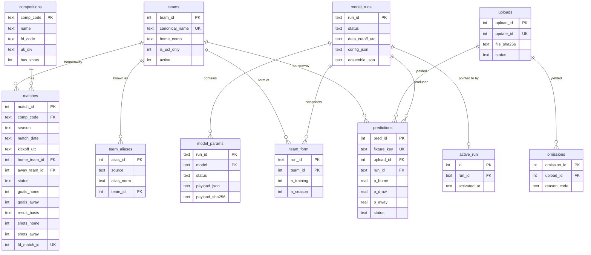

Operational tables with no foreign-key relationships (not drawn): `processed_updates`, `source_fetch_log`, `job_runs`, `events`, `calibration_snapshots`.

### 5.2 Reference tables

**`competitions`** — 10 rows, seeded.

| Column | Type | Constraint / note |
|---|---|---|
| comp_code | TEXT | PK. One of `EPL, LL, BL, SA, L1, UCL, ERE, PPL, CHA, SPL` |
| name | TEXT | NOT NULL |
| fd_code | TEXT | football-data.org code: `PL, PD, BL1, SA, FL1, CL, DED, PPL, ELC`; NULL for SPL |
| uk_div | TEXT | football-data.co.uk division file: `E0, SP1, D1, I1, F1, N1, P1, E1, SC0`; NULL for UCL |
| has_shots | INTEGER | 1 for the nine domestic leagues, 0 for UCL |

**`teams`** — 179 active rows seeded from `data/canonical_teams.json`, plus ≈ 60 history-only rows (`active=0`) seeded from `data/historical_teams.json` [Rev-1, ADR-027].

| Column | Type | Constraint / note |
|---|---|---|
| team_id | INTEGER | PK |
| canonical_name | TEXT | UNIQUE NOT NULL — exactly the PRD canonical spelling |
| home_comp | TEXT | FK `competitions`; NULL for UCL-only clubs |
| is_ucl_only | INTEGER | 0/1 |
| active | INTEGER | 1 for the 2026–27 list; 0 for history-only clubs (from `data/historical_teams.json`, or a club that later left the list) so history still joins [Rev-1] |

**`team_aliases`** — one row per (source spelling → team).

| Column | Type | Constraint / note |
|---|---|---|
| alias_id | INTEGER | PK |
| source | TEXT | CHECK in (`fd_org`, `fd_uk`, `screener`, `manual`) |
| alias_norm | TEXT | Normalised spelling: NFKD, accents stripped, lower-case, punctuation → space, whitespace collapsed |
| team_id | INTEGER | FK `teams` NOT NULL |
| | | UNIQUE (`source`, `alias_norm`) |

An alias that resolves to two teams is impossible by the unique key. A source spelling with no row is **unmapped** (reported, never guessed).

### 5.3 Results data

**`matches`**

| Column | Type | Constraint / note |
|---|---|---|
| match_id | INTEGER | PK |
| comp_code | TEXT | FK, NOT NULL |
| season | TEXT | e.g. `2026-27` (Aug–May) |
| match_date | TEXT | UTC calendar date, NOT NULL |
| kickoff_utc | TEXT | NULL for co.uk-only rows without a time |
| home_team_id, away_team_id | INTEGER | FK `teams`, NOT NULL, CHECK different |
| status | TEXT | CHECK in `SCHEDULED, TIMED, IN_PLAY, FINISHED, POSTPONED, CANCELLED, SUSPENDED, AWARDED` |
| goals_home, goals_away | INTEGER | **90 minutes plus stoppage time only.** NULL until `FINISHED`. CHECK 0..20 |
| result_basis | TEXT | CHECK in `regular`, `ft_90`, `unverified` — how the 90-minute score was obtained (ADR-010) |
| shots_home, shots_away | INTEGER | NULL when unavailable; not populated or used in v1 (ADR-026) [Rev-1] |
| fd_match_id | INTEGER | UNIQUE, NULL for co.uk-only rows |
| uk_key | TEXT | co.uk natural key (division/date/teams) for idempotent upsert |
| goals_source | TEXT | `fd_org` or `fd_uk` |
| updated_at | TEXT | |
| | | UNIQUE (`comp_code`, `season`, `match_date`, `home_team_id`, `away_team_id`) |
| | | Indexes: (`home_team_id`, `match_date`), (`away_team_id`, `match_date`), (`comp_code`, `match_date`), (`status`, `match_date`) |

**`source_fetch_log`** — audit of every external fetch (also the cache metadata for conditional GETs).

| Column | Type |
|---|---|
| fetch_id (PK), source, resource, fetched_at, http_status, ok (0/1), etag, last_modified, content_sha256, rows, bytes | |

### 5.4 Model registry (the "model registry" of RESOURCE 3)

**`model_runs`** — immutable once `active` (only `status` may change afterwards).

| Column | Type | Note |
|---|---|---|
| run_id | TEXT | PK, `R` + UTC timestamp, e.g. `R20261016T011742Z` |
| status | TEXT | CHECK in `building, active, superseded, rejected, failed` |
| started_at, finished_at | TEXT | |
| data_cutoff_utc | TEXT | Latest result included; the stale-run guard compares to it |
| training_from, training_to | TEXT | Window actually used |
| git_sha, code_version | TEXT | Reproducibility |
| config_json | TEXT | **Snapshot** of thresholds (drift, minimum matches, stale hours), league baselines (H/D/A and over frequencies) and flags such as `"unvalidated": true` |
| ensemble_json | TEXT | Weights per model, method, number of scored matches used |
| diagnostics_json | TEXT | Convergence stats, sanity-check results, row counts, unmapped teams |

**`active_run`** — exactly one row.

| Column | Type | Note |
|---|---|---|
| id | INTEGER | PK, CHECK (id = 1) |
| run_id | TEXT | FK `model_runs` |
| activated_at | TEXT | |

**`model_params`**

| Column | Type | Note |
|---|---|---|
| run_id, model | TEXT | Composite PK; `model` CHECK in `dc, pi, bp` |
| status | TEXT | CHECK in `ok, failed` |
| payload_version | INTEGER | Lets the bot reject payloads it does not understand (additive evolution) |
| payload_json | TEXT | Per-model parameters for all teams (≈ 30–60 KB) |
| payload_sha256 | TEXT | Integrity check on read |
| error | TEXT | Failure reason when `failed` |

**`team_form`** — per run, per team (drives the drift filter and the "< 10 matches" rule without recomputing on the Worker).

| Column | Type |
|---|---|
| run_id, team_id | PK pair |
| n_training | matches inside the training window |
| n_season | matches in the current season |
| season_gf, season_ga | goals for/against per match this season |
| l10_n, l10_gf, l10_ga | last-10 window |
| shots_n, season_sf, season_sa, l10_sf, l10_sa | shots; NULL in v1 (shots drift deferred, ADR-026) [Rev-1] |
| latest_match_date | Freshness per team |

**[Rev-4]** `team_form` has a row for every active team of the run; a team without matches (for example the dropped Scottish clubs) has `n_training = 0` and NULL means, and the Worker treats it as INSUFFICIENT_HISTORY. `model_params` also carries a CHECK that an `ok` row has its payload, version and hash. The CHECK lists on `model` and `status` are fixed by this schema: adding a fourth model or a new run status needs a table-rebuild migration, not a plain additive one.

### 5.5 Prediction log

**`uploads`**

| Column | Type | Note |
|---|---|---|
| upload_id | INTEGER | PK |
| update_id | INTEGER | UNIQUE — Telegram update id |
| received_at | TEXT | |
| tg_file_unique_id, file_sha256, size_bytes | | |
| run_date_utc | TEXT | From the file, if parsed |
| schema_version | INTEGER | |
| n_matches_in, n_excluded_in, n_published, n_omitted, n_duplicate | INTEGER | |
| run_id | TEXT | Active run used |
| status | TEXT | CHECK in `received, rejected, processed, failed`. **[Rev-1, ADR-029]** The row is inserted as `received` before any heavy work, so an upload that is never finalised can be found by the watchdog |
| error_code | TEXT | From the error catalogue (§6.6) |

**`predictions`** — one row per published fixture; **immutable except for result/scoring columns**.

| Column | Type | Note |
|---|---|---|
| pred_id | INTEGER | PK |
| fixture_key | TEXT | **UNIQUE** — `<kickoff_date_utc>\|<comp>\|<home_team_id>\|<away_team_id>` |
| upload_id, run_id | | FKs |
| label | TEXT | The screener's `match_id`, display only |
| comp_code, kickoff_utc, home_team_id, away_team_id | | |
| p_home, p_draw, p_away | REAL | NOT NULL, stored at full precision (not rounded); CHECK sum within 1e-6 of 1 [Rev-1] |
| p_over_05, p_over_15, p_over_25, p_over_35, p_over_45, p_over_55 | REAL | NOT NULL, full precision [Rev-1] |
| grid_json | TEXT | The ensemble grid (13×13) at 6 decimals — makes every metric recomputable |
| models_json | TEXT | Per model: status, 1X2, total-goals pmf — used for rolling per-model RPS |
| weights_json | TEXT | Weights actually applied (after dropping failed models) |
| drift_json | TEXT | Drift statistics and verdict |
| inputs_json | TEXT | Screener fields: lineup_status, absences, rest days, source URLs, note |
| status | TEXT | CHECK in `pending, scored, void` |
| void_reason | TEXT | `POSTPONED`, `CANCELLED`, `SUSPENDED`, `AWARDED`, `UNVERIFIED_RESULT`, `NO_RESULT` (added Rev-1, ADR-028) |
| goals_home, goals_away | INTEGER | Filled when scored (90-minute basis) |
| rps_1x2, rps_totals, logloss_1x2 | REAL | Filled when scored |
| created_at, scored_at | TEXT | |
| | | Indexes: (`status`, `kickoff_utc`), (`comp_code`, `kickoff_utc`) |

**`omissions`** — matches in a file that did not produce a prediction.

| Column | Type | Note |
|---|---|---|
| omission_id | INTEGER | PK |
| upload_id | INTEGER | FK |
| label | TEXT | The screener's `match_id` |
| reason_code | TEXT | `UNMAPPED_TEAM, INSUFFICIENT_HISTORY, DRIFT, STARTED, TOO_FAR, DATE_MISMATCH, NO_MODEL, DUPLICATE_PAIR` |
| detail_json | TEXT | |
| | | UNIQUE (`upload_id`, `label`) |

**`processed_updates`** — Telegram dedupe. `update_id` PK, `received_at`, `kind`, `outcome`.

### 5.6 Operations

| Table | Purpose | Key columns |
|---|---|---|
| `job_runs` | One row per nightly/backtest/report/bootstrap job | `job_id`, `kind`, `started_at`, `finished_at`, `status`, `git_sha`, `summary_json`, `error` |
| `events` | Durable, compact structured events (alerts raised, unmapped teams, anomalies, ignored chats count). Pruned at 90 days | `event_id`, `at`, `level`, `source`, `kind`, `detail_json`, `dedupe_key` |
| `calibration_snapshots` | Weekly metrics for history | `snapshot_id`, `created_at`, `window_from`, `window_to`, `n_scored`, `metrics_json`, `run_id` |

### 5.7 Invariants (enforced in code and tests)

1. `active_run.run_id` always refers to a `model_runs` row with `status='active'` and at least one `model_params` row with `status='ok'`.
2. Exactly one `predictions` row per `fixture_key`; its probability columns are never updated.
3. `goals_*` in `matches` are 90-minute scores or NULL; `result_basis='unverified'` rows are excluded from training and scoring.
4. Every probability row satisfies `p_home + p_draw + p_away = 1 ± 1e-6` and `p_over_05 ≥ p_over_15 ≥ … ≥ p_over_55`.
5. A run is promoted (`active_run` updated) only after its sanity checks pass (§8.6).
6. [Rev-1] An `uploads` row still `received` after 10 minutes raises an alert (§9.2).

---

## 6. API / interface layer (design phase 5)

This system has no public REST API. Its interfaces are: (I-1) the screener file contract, (I-2) the Telegram inbound webhook, (I-3) Telegram outbound calls, (I-4) internal TypeScript module interfaces, (I-5) the Python CLI, (I-6) external data APIs consumed, (I-7) D1 access paths.

### 6.1 I-1 — Screener file contract, schema version 1 (Zod on the Worker; JSON Schema copy in `packages/contracts`)

| Field | Type / rule |
|---|---|
| `schema_version` | literal `1` — anything else → `E_SCHEMA_VERSION` |
| `run_date_utc` | `YYYY-MM-DD`, a real calendar date |
| `notes` | string ≤ 2,000 chars, or `null` |
| `matches` | array, 0–100 items |
| `matches[].match_id` | string 1–160 chars; **opaque label** |
| `matches[].competition` | enum: `EPL, LL, BL, SA, L1, UCL, ERE, PPL, CHA, SPL` |
| `matches[].home`, `.away` | string 1–64; canonical name; must differ |
| `matches[].kickoff_utc` | `YYYY-MM-DDTHH:MM:00Z`, valid instant |
| `matches[].lineup_status` | enum `none, expected, confirmed` |
| `matches[].absences_home`, `.absences_away` | `null` or array ≤ 40 of `{player: string ≤ 80, status: "out"\|"doubtful", source_url: https URL ≤ 300}` |
| `matches[].rest_days_home`, `.rest_days_away` | integer 0–60, or `null` |
| `matches[].source_urls` | array ≤ 20 of https URLs ≤ 300 |
| `excluded` | array ≤ 200 of `{match: string ≤ 200, reason: string ≤ 40}`; unknown reasons are kept and counted as `OTHER` |

Rules:
- Unknown extra keys are stripped, not fatal (so a harmless prompt change does not brick the day); a **missing or mistyped required key** is fatal.
- Contract evolution: any change that is not purely additive-optional becomes `schema_version: 2` handled by a *new* parser alongside v1 (never mutate v1).
- Never rendered raw: `notes`, player names and URLs are length-capped and escaped when echoed (prompt-injection / formatting-injection defence).
- Business checks after parsing (each produces an omission, not a file rejection): kickoff date equals `run_date_utc`; kickoff strictly after *now* and ≤ now + 48 h; both teams resolve to `teams`; home ≠ away.

### 6.2 I-2 — Telegram inbound webhook

| Aspect | Definition |
|---|---|
| Endpoint | `POST /tg/<WEBHOOK_PATH_SECRET>` on the Worker. Every other path/method → `404` |
| Registration | `setWebhook` with `secret_token`, `allowed_updates=["message"]`, `drop_pending_updates=false` — run once by `scripts/set-webhook` and re-checked in post-deploy smoke |
| Header | `X-Telegram-Bot-Api-Secret-Token` must equal `TELEGRAM_WEBHOOK_SECRET` (constant-time compare) else `401` |
| Allowed sender | private chat whose `chat.id == ALLOWED_CHAT_ID` and `from.id == ALLOWED_USER_ID` — anything else → `200` with no reply, one counter event |
| Update kinds | `message.document` → intake pipeline; any other allowed-sender message → usage hint |
| Response | Always `200` quickly once authenticated (so Telegram does not retry); work continues in `ctx.waitUntil`. [Rev-1] The `uploads` row is inserted with status `received` before any heavy work (ADR-029) |

### 6.3 Behaviour matrix (what Divine sees)

| Situation | Bot reply | Logged |
|---|---|---|
| Valid file, all matches pass | 1+ messages with probabilities + footer | `uploads`, `predictions` |
| Valid file, some omitted | Probabilities for the rest + "Omitted:" list with reasons | + `omissions` |
| Valid file, zero matches | "File valid: 0 matches passed the screener (N excluded: …)" | `uploads` |
| Fixture already logged | Same numbers from the log, marked "already logged" | `uploads` (n_duplicate) |
| Not `.json`, wrong size, not JSON, bad schema, wrong version | One error message naming the problem (first ≤ 5 validation paths, no file content echoed) | `uploads` (rejected) |
| Telegram file download fails | "Could not download the file. Please resend." | `uploads` (failed) |
| No active model run / all models failed | "No usable model run — nothing computed." | event + alert |
| Text or other message from Divine | "Upload the screener .json file as a document." | none |
| Any message from another chat | nothing | counter event only |
| Active run older than 36 h | Normal reply with a **STALE MODELS** banner | event |
| [Rev-1] Upload acknowledged but never answered (for example Worker killed at the CPU limit) | No reply; alert to Divine within about 6 h | `uploads` stays `received`, event + alert |

### 6.4 I-3 — Telegram outbound

| Call | Use | Notes |
|---|---|---|
| `getFile`, then file download | Fetch the upload | Download URL contains the bot token → never logged |
| `sendMessage` | Replies, split ≤ 3,900 chars at match boundaries | Plain text (no Markdown parsing → no escape failures); 429 handling with `retry_after` if ≤ 5 s |
| `sendPhoto` | Weekly calibration chart from the fit job | Optional in Phase 6 |

### 6.5 I-4 — Internal module interfaces (TypeScript, in `apps/bot/src`)

Interfaces are the *only* way modules talk; signatures are contracts reviewed in pull requests.

| Module | Interface | Notes |
|---|---|---|
| `auth` | `verifyWebhook(req): Result<Ok, AuthError>`; `checkSession(update): Session \| null` | **The only module that reads webhook secret, chat id or user id.** Locked-block requirement |
| `intake` | `parseScreenerFile(bytes): Result<ScreenerV1, IntakeError>` | Size cap, UTF-8, JSON parse, Zod |
| `repo` | `RunRepository`, `PredictionRepository`, `UpdateRepository`, `TeamRepository` (see below) | **The only module that touches D1.** Batched calls |
| `engine` | `buildGrid(model, params, home, away): Grid`; `mixGrids(grids, weights): Grid`; `markets(grid): Markets` | Pure functions; no I/O |
| `drift` | `evaluate(formHome, formAway, config): DriftVerdict` | Pure |
| `format` | `renderReply(results, ctx): string[]` | Pure; splitting included |
| `telegram` | `send(chatId, text[])`, `download(fileId)` | Wraps grammY `api` + `fetch` |
| `watchdog` | `scheduled(event, env)` | Cron trigger entry |

`repo` surface (names are normative; bodies are Essentials work):
`RunRepository.loadActive(teamIds) → {run, config, ensemble, params[], forms[]}` (one consistent read), `PredictionRepository.insertManyIgnoreDuplicates(rows)`, `PredictionRepository.findByFixtureKeys(keys)`, `UploadRepository.record(upload)` (inserts as `received` first and finalises later; plus `findStale(olderThanMinutes)` for the watchdog) [Rev-1], `UpdateRepository.markProcessed(updateId) → firstTime: boolean`, `TeamRepository.resolveCanonical(names) → map`, `EventRepository.record(event)`.

### 6.6 Error catalogue (shared by code, tests, replies, logs)

| Code | Meaning | User-visible | HTTP to Telegram |
|---|---|---|---|
| `E_NOT_JSON_FILE` | Not a `.json` document | yes | 200 |
| `E_TOO_LARGE` | > 256 KB | yes | 200 |
| `E_DOWNLOAD_FAILED` | `getFile`/download failed | yes | 200 |
| `E_PARSE` | Not valid UTF-8 JSON | yes | 200 |
| `E_SCHEMA_VERSION` | `schema_version` ≠ 1 | yes | 200 |
| `E_SCHEMA_INVALID` | Zod validation failure | yes (≤ 5 paths) | 200 |
| `E_NO_RUN` | No usable active run | yes | 200 |
| `E_INTERNAL` | Unexpected exception | yes: "Internal error, id=…" | 200 |
| `E_AUTH` | Bad secret header | no | 401 |

Omission codes are in §5.5. A `Result<T,E>` type is used for expected failures; exceptions are reserved for bugs.

### 6.7 I-5 — Python CLI (`apps/fit`, entry point `footy`)

| Command | Does | Used by |
|---|---|---|
| `footy bootstrap` | One-off: load canonical teams/aliases, the history-only clubs and 3-season history from the hand-loaded co.uk files (`footy load-csv`) or, in the fallback, from football-data.org (and earlier UCL if the free tier allows) [Rev-2]; writes `matches` through the repo layer in chunked, resumable bound-parameter statements [Rev-1, ADR-031] | Manual workflow |
| `footy load-csv --dir <path>` | [Rev-2, ADR-035] Parse football-data.co.uk CSV files that Divine downloaded by hand into a local folder (never inside the repo); reconcile and upsert `matches` through the repo layer; idempotent; used for the 3-season history and for weekly Scottish Premiership refreshes. Run on Divine's machine with the D1-only token in a local environment variable. Not used under the fallback | Manual, local |
| `footy ingest` | Incremental fetch of football-data.org (last 7 days + next 3); football-data.co.uk is never fetched automatically [Rev-2]; reconcile and upsert | Nightly |
| `footy score` | Fill results into `predictions`; void postponed/cancelled and `NO_RESULT` after 3 days [Rev-1]; compute RPS/log loss | Nightly |
| `footy fit` | Train DC/pi/BP, compute ensemble weights, baselines and `team_form`, run sanity checks, write run as `building` | Nightly |
| `footy publish` | Atomically promote the run (`active_run`) if it passed the checks; mark previous `superseded`; prune | Nightly |
| `footy report` | Weekly calibration message (+ chart) | Monday |
| `footy backtest` | Walk-forward evaluation, compare with committed baseline metrics | Monthly / manual |
| `footy healthcheck` | Run-age and freshness checks (used by humans and CI smoke) | Manual |
| `footy alert --text` | Send a Telegram alert (used on workflow failure) | Workflow `if: failure()` |

Exit codes: `0` ok, `2` data/validation failure, `3` source outage (cached data used), `4` fit failure (partial), `1` unexpected. Workflows alert on non-zero.

**[Rev-4]** As built: `footy backtest [--models dc,pi,bp] [--test-days N] [--fold-days N] [--half-lives a,b] [--shrinks a,b] [--out FILE]` (needs only D1; writes a `job_runs` row, the readable report goes to stderr); `footy fit [--models ...] [--as-of YYYY-MM-DD]`; `footy publish [--run-id ID | --rollback ID]`. Model commands need only the D1 variables; the football-data.org legal gate applies to `bootstrap` and `ingest` only. A gate rejection, a failed model and a backtest with a failed fold all exit with code 4.

### 6.8 I-6 — External APIs consumed

| Source | Used for | Details |
|---|---|---|
| football-data.org v4 | Fixtures, results, UCL, team lists | `GET /v4/competitions/{code}/matches?dateFrom=&dateTo=`; header `X-Auth-Token`; free tier 10 requests/minute; fields used: `id, utcDate, status, homeTeam.name, awayTeam.name, score.duration, score.fullTime, score.regularTime`; competition codes in §5.2 |
| football-data.co.uk | History, shots, SPL | CSV per division per season, e.g. `mmz4281/2526/E0.csv`; columns used: `Div, Date, Time (if present), HomeTeam, AwayTeam, FTHG, FTAG, HS, AS` (**verify headers at build**); read from local files that Divine downloads by hand and loads with `footy load-csv`; never fetched automatically [Rev-2, ADR-035] |
| Telegram Bot API | See I-2/I-3 | |
| Cloudflare D1 REST API | Python → D1 | `POST /accounts/{id}/d1/database/{db}/query`; D1-only token; ≤ 100 bound parameters per statement; bulk bootstrap uses chunked multi-row bound-parameter statements through `d1_client.py` (resumable), never SQL files with literal values [Rev-1, ADR-031] |

### 6.9 I-7 — D1 access paths

| Client | Path | Rule |
|---|---|---|
| Worker | D1 binding, through `apps/bot/src/repo/*` only | Parameterised statements only; `batch()` for multi-statement reads/writes |
| Fit job | D1 REST through `apps/fit/src/footy/repo/d1_client.py` only | Retries with backoff; single place for SQL |
| Schema | `wrangler d1 migrations apply` | Only in deploy workflow / manual workflow |

---

## 7. High-level architecture (design phase 6)

Architecture style: **two-runtime batch-fit / online-serve system around one SQLite database**, no servers to operate. Diagrams follow the C4 model (Context → Container → Component; Level 4 is the ER diagram in §5 and the interface tables in §6), as required by the project's C4 resource.

### 7.1 C4 Level 1 — System context

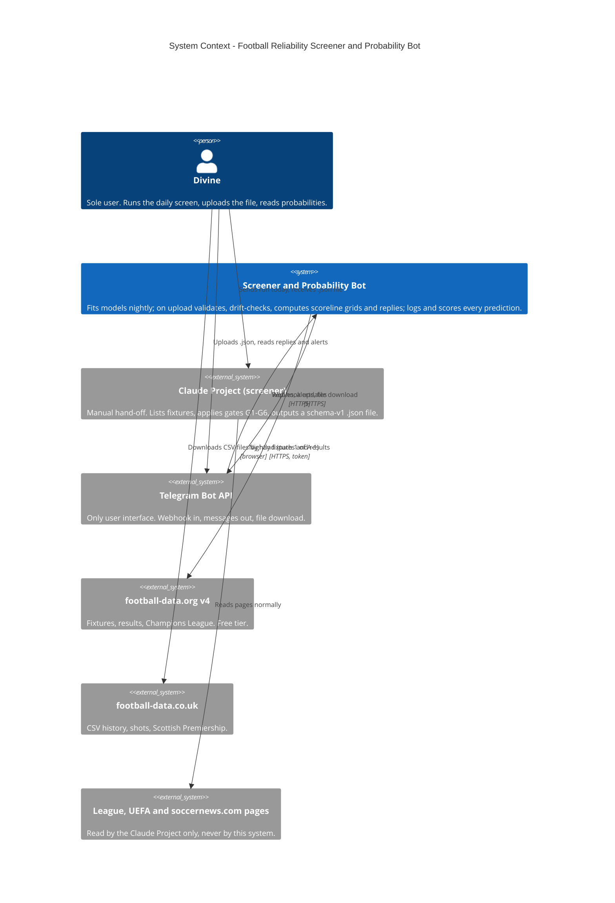

### 7.2 C4 Level 2 — Containers

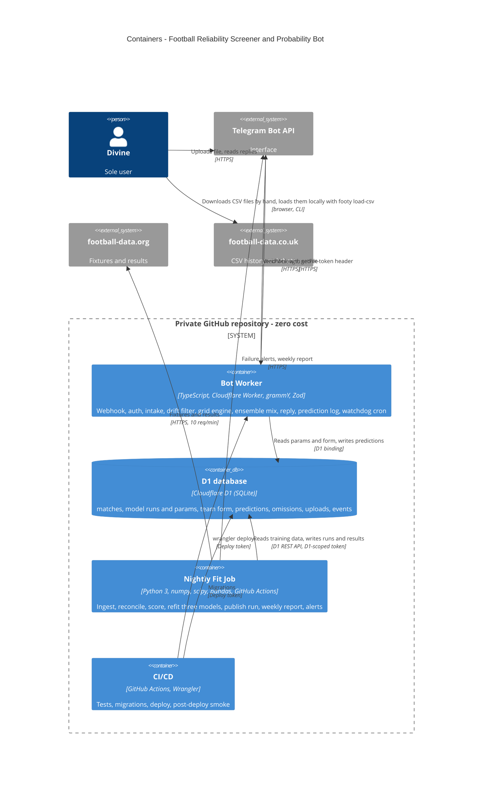

### 7.3 C4 Level 3 — Bot Worker components

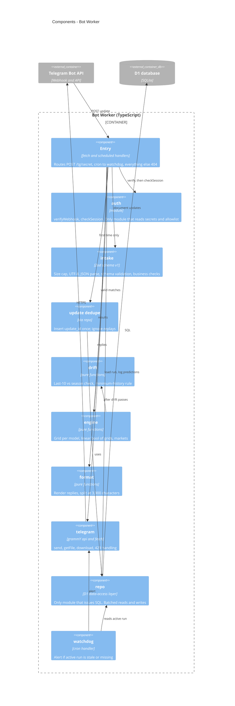

### 7.4 C4 Level 3 — Fit job components

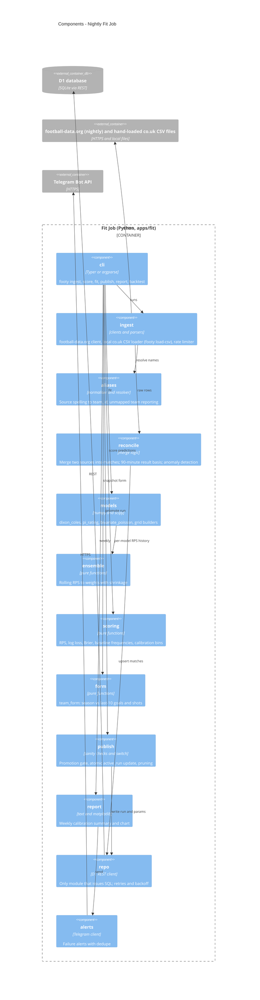

### 7.5 Deployment view

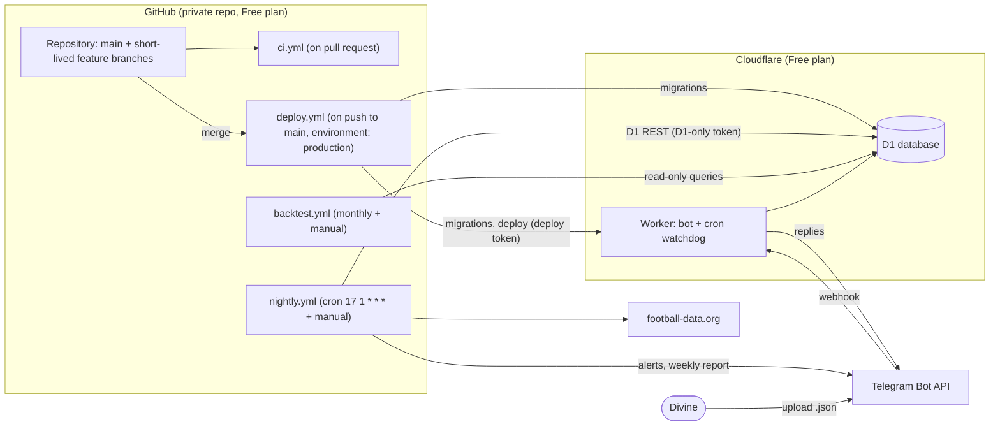

### 7.6 Project structure (single private repository)

```
/                                  repo root
├── claude.md                      coding-agent guardrail (read order, drift checks, 12 rules)
├── prd/                           PRD_N.md (versioned, immutable snapshots)
├── system_architecture/           system_architecture_N.md (versioned, immutable snapshots)
├── essentials/                    system_architecture_essential_N.md (per build phase)
├── tracker/                       written by Claude Code during implementation (dated entries)
├── apps/
│   ├── bot/                       Cloudflare Worker (TypeScript)
│   │   ├── src/
│   │   │   ├── index.ts           fetch + scheduled entry points only
│   │   │   ├── auth/              verifyWebhook, checkSession
│   │   │   ├── intake/            Zod schema v1, size/UTF-8/JSON guards, business checks
│   │   │   ├── engine/            grid builders (dc, pi, bp), mixGrids, markets
│   │   │   ├── drift/             drift evaluation
│   │   │   ├── format/            reply rendering + splitting
│   │   │   ├── telegram/          grammY wiring, send/download, 429 handling
│   │   │   ├── repo/              D1 data-access layer (only SQL in the Worker)
│   │   │   ├── watchdog/          cron staleness check
│   │   │   └── config/            constants, error catalogue
│   │   ├── test/                  Vitest (Workers pool): unit, repo-on-local-D1, e2e-with-fakes
│   │   └── wrangler.toml
│   └── fit/                       Python package `footy`
│       ├── src/footy/
│       │   ├── cli.py
│       │   ├── ingest/            fd_org client, fd_uk csv, rate limiter
│       │   ├── aliases/           normaliser, resolver
│       │   ├── reconcile/         merge, 90-minute basis, anomalies
│       │   ├── models/            dixon_coles.py, pi_rating.py, bivariate_poisson.py, grid.py
│       │   ├── ensemble/
│       │   ├── scoring/           rps, logloss, baselines, calibration
│       │   ├── form/
│       │   ├── publish/
│       │   ├── report/
│       │   ├── alerts/
│       │   └── repo/              d1_client.py (only SQL in Python)
│       └── tests/                 pytest: unit, property, golden vectors, synthetic backtest
├── packages/
│   └── contracts/                 screener_v1.schema.json, golden fixtures, golden grid vectors
├── data/
│   ├── canonical_teams.json       canonical names per competition (from PRD_1 §12)
│   ├── historical_teams.json      history-only (inactive) clubs for the 3-year window [Rev-1]
│   └── aliases/                   fd_org.json, fd_uk.json, screener.json (our own mapping files)
├── db/
│   └── migrations/                0001_*.sql ... (additive-first, never edited after merge)
├── scripts/                       set-webhook, smoke checks
├── docs/legal/                    source_terms_register.md (§9.8)
└── .github/workflows/             ci.yml, deploy.yml, data.yml [Rev-3], nightly.yml, backtest.yml
```

**[Rev-4]** As built, the fit package also has `backtest/` (walk-forward, report, job), `models/{structure,registry,types,golden}.py`, `fitting.py` (the `fit` job), `repo/{training,models}.py` and `ensemble/weights.py`; `scoring/` holds the baseline and the calibration bins. The Worker's `repo/index.ts` gained `runs.readActive()` and `payloadVerifies()`.

Rules: no raw source data (CSV, API dumps) is ever committed — tests use synthetic generators (ADR-025); secrets only in GitHub/Cloudflare secret stores; the bot imports nothing from `apps/fit` and vice versa; the only shared artifacts are `packages/contracts`, `data/`, and `db/migrations`.

### 7.7 "Frontend / backend flow"

There is no frontend. **Telegram is the UI**; the flow from Divine's point of view is a three-step ritual:

1. 08:00 IST — "run today" in the Claude Project → receives `screener_YYYY-MM-DD.json`.
2. Upload that file to the bot chat as a document.
3. Read the reply messages (probabilities, omissions, footer with model run and warnings).

Backend flow: Telegram → Worker (auth → dedupe → intake → read D1 → drift → engine → log → render) → Telegram. Nothing else is user-facing; alerts and the weekly report arrive as ordinary Telegram messages from the same bot.

### 7.8 Authentication flow

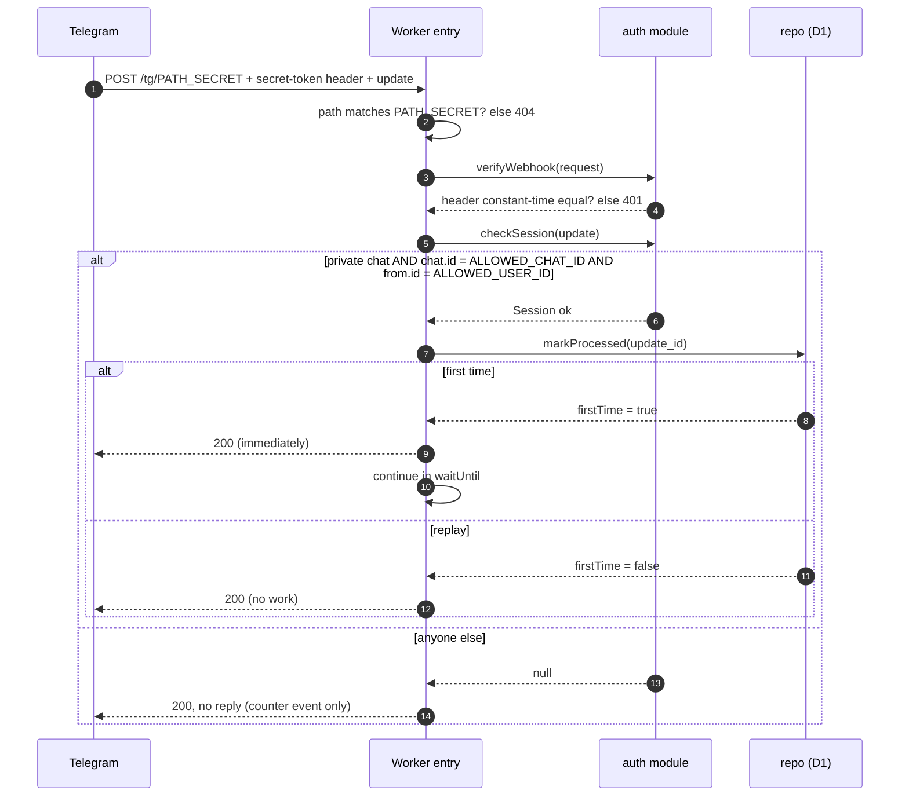

Three independent layers, in order: unguessable path → Telegram secret-token header → chat-and-user allowlist. All three live behind `auth` (locked extensibility rule); swapping the scheme touches one module.

### 7.9 Data flow — nightly (01:17 UTC)

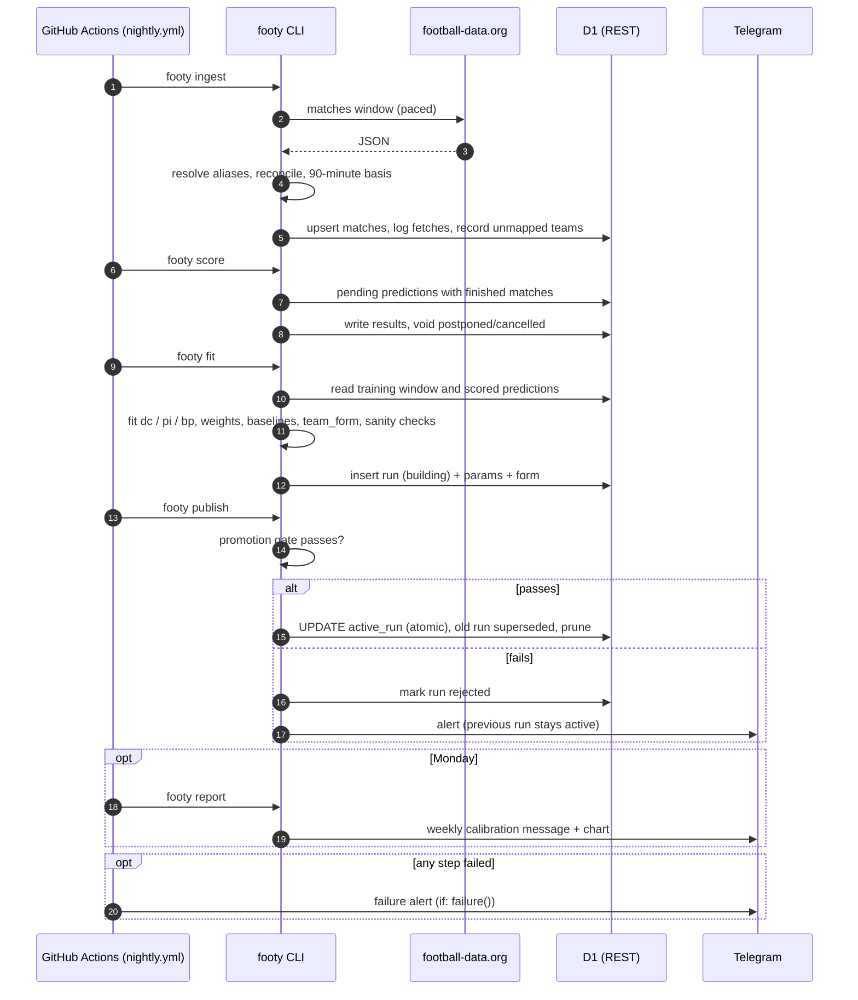

### 7.10 Data flow — morning upload

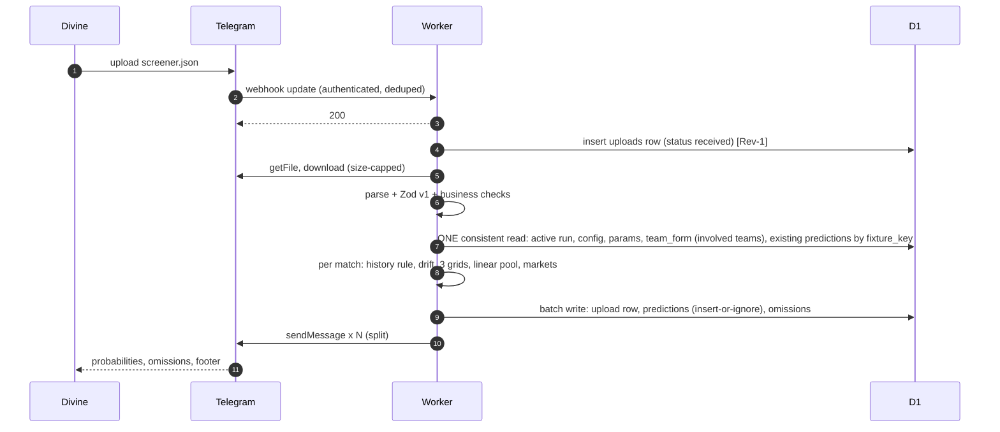

Order matters: **persist, then reply.** A reply never exists without its log row; if sending fails after persisting, a re-upload is answered from the log with identical numbers.

### 7.11 State machines

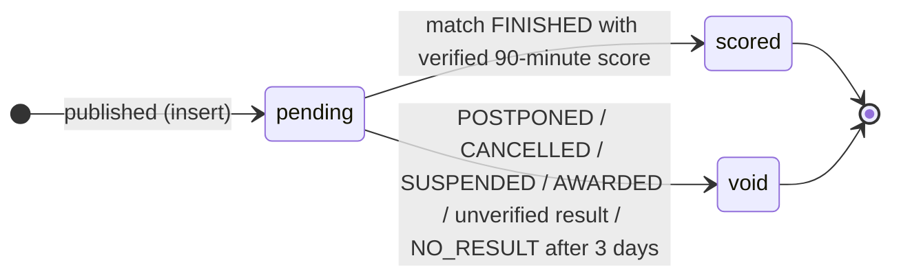

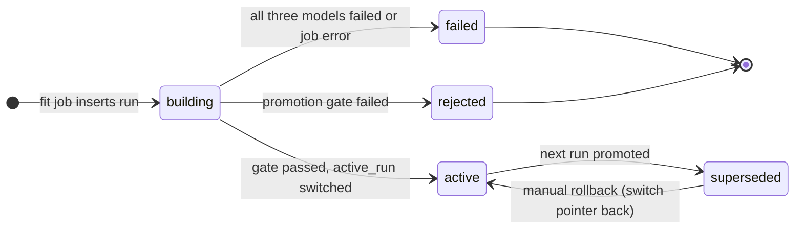

---

## 8. Critical components — deep dive (design phase 7)

### 8.1 Grid engine and markets

**One grid per match.** Home goals i and away goals j, 0 ≤ i, j ≤ 12 (13×13 = 169 cells). Each model produces a grid; the ensemble is the **weighted linear pool** of the available grids, `G = Σ w_m · G_m` with `Σ w_m = 1`, so `ΣG = 1` automatically. Every market is derived from `G`:

- P(home) = Σ_{i>j} G, P(draw) = Σ_{i=j} G, P(away) = Σ_{i<j} G.
- P(over L) for L ∈ {0.5,…,5.5} = Σ_{i+j > L} G; Under = 1 − Over (computed, never stored separately).
- Total-goals pmf (0..11, 12+) is derived once and used for RPS on totals.

Properties (property-tested in both languages): grid ≥ 0, sums to 1 within 1e-9, tail mass beyond 12 goals < 1e-6 before renormalisation **[Rev-4: measured to hold per side up to about 2.3 goals; above that the grid is still renormalised and still sums to 1]**, overs monotone non-increasing in L, mirror symmetry when home/away parameters are swapped with home-advantage removed.

Cross-language parity: Python is the reference. `packages/contracts/golden/` holds JSON vectors (inputs → grid cells and markets) produced by Python; Vitest asserts the TypeScript engine matches cell by cell within 1e-9 (no cross-language hash) [Rev-1]. This is the training-serving-skew control (RESOURCE 3).

**[Rev-4] Extreme-fixture guard (ADR-039).** When a grid is built from fitted parameters, each goal rate is clipped to 0.01..6 and the Dixon-Coles rho is clamped to the interval in which every correction factor stays positive (from -0.999 / max(lambda, 1) to min(0.999, 0.999 / (lambda_home x lambda_away))). Inside the normal range this changes nothing; for a very strong side against a very weak one it prevents a negative factor (which crashed a test backtest). The golden vectors include clipped and clamped cases, so any other implementation must apply the same rule.

### 8.2 Models (all implemented in-house with numpy/scipy; `penaltyblog` is an optional test oracle, not a runtime dependency — ADR-019)

| Model | What it estimates | Grid construction | Stored payload |
|---|---|---|---|
| **Dixon-Coles (dc)** | Per-team attack/defence, home advantage, league offsets, low-score correction ρ, with exponential time-decay weights | Independent Poisson with the Dixon-Coles τ adjustment on (0,0),(0,1),(1,0),(1,1), renormalised | team parameters, league offsets, ρ, home advantage, decay ξ |
| **Pi-rating (pi)** | Per-team home and away ratings updated chronologically from score discrepancies (Constantinou & Fenton, 2013; formulas and constants are taken from the paper at build time and unit-tested against hand-computed examples) | Rating difference → expected goal difference d; with league total-goals level T: λ_home = max(ε, (T+d)/2), λ_away = max(ε, (T−d)/2); independent-Poisson grid. **Hypothesis** (ADR-006) | ratings, per-league T, mapping constants |
| **Bivariate Poisson (bp)** | Per-team attack/defence plus a shared covariance term λ3 | Karlis–Ntzoufras bivariate Poisson pmf: P(i,j) = e^{−(λ1+λ2+λ3)} · λ1^i/i! · λ2^j/j! · Σ_{k≤min(i,j)} C(i,k)C(j,k)k!(λ3/(λ1λ2))^k | team parameters, λ3, home advantage |

Cross-league handling (ADR-007, **hypothesis**): the three models fit on one pooled match set. Leagues are only weakly connected (Champions League matches, plus promoted/relegated clubs moving between divisions in the window), so team parameters are **shrunk toward their league mean** and league offsets are identified through those links. UCL replies carry a note that cross-league strength is the weakest-identified quantity. The walk-forward backtest reports per-competition RPS so a competition where this fails is visible rather than hidden.

Time decay: weight of a match = `exp(−ξ·age_days)`; initial half-life 300 days (a starting value tuned in the backtest, **unvalidated**).

Failure semantics (ADR-019/FR-07): a model that fails convergence or sanity checks tonight is stored with `status='failed'`, **not** silently replaced by yesterday's parameters; the bot runs the others and prints "model X unavailable".

Sanity checks per model before storing `ok`: optimiser success, finite parameters, all |attack/defence| within bounds, mean λ per league in [0.3, 3.5], a test grid for a typical fixture sums to 1.

**[Rev-4] As built (Stages 3 and 4).** (a) Dixon-Coles and bivariate Poisson share one pooled parameterisation: intercept, home advantage, league offsets and team deviations shrunk toward their league mean by a ridge (`shrink_team` 4, `shrink_league` 0.1, unvalidated); fitted with L-BFGS-B and an analytic gradient, at most 3000 iterations, tolerance 1e-10 (the first values, 500 and 1e-12, failed on real data in a few folds), no warm start (a cold fit takes about 1 s for Dixon-Coles and about 20 s for bivariate Poisson on a production-sized set). A fit with fewer than 50 matches in the window fails. (b) The bivariate Poisson gradient uses dP(x,y)/dlambda1 = P(x-1,y) - P(x,y) (likewise lambda2; lambda3 with P(x-1,y-1)); lambda3 is one shared constant. (c) Pi-rating constants were verified against the paper (verify-at-build item 8): lambda 0.035, gamma 0.7, b 10, c 3, psi(e) = 3 log10(1+e), initial rating 0. The grid mapping adds one fitted scale s (observed on predicted goal difference, through the origin, clipped to 0.2..2), so d = s x gD before the T +/- d split. The pi-rating is league-agnostic and has no shrinkage. (d) The training window and the time decay end at the data cut-off (the latest stored verified result) or at `--as-of`.

### 8.3 Ensemble weighting (ADR-020)

For each model m let `RPS̄_m` be its mean RPS (1X2) over the most recent N = 200 scored predictions that have a stored per-model probability. Raw weight `w̃_m = exp(−κ · RPS̄_m)`, normalised to `w_rps`. With `n` scored predictions available, final weight `w = (n/(n+50))·w_rps + (50/(n+50))·(1/M)` over the M models that fit tonight. Until the first scored predictions exist, **initial weights come from the walk-forward backtest** (run at launch) and equal weights if that is unavailable. κ is a backtest-tuned starting value, **unvalidated**. Weights are written into `model_runs.ensemble_json` and copied into every prediction (`weights_json`).

**[Rev-4] As built (ADR-040).** `w = n/(n+50) x w_rps + 50/(n+50) x w_prior`, where `w_prior` is the softmax of the walk-forward backtest's mean RPS when a stored `backtest` summary covers every fitted model, and equal weights otherwise (the rule written above). kappa = 100, because RPS differences between the models are about 0.001 to 0.01. All are starting values, unvalidated. In the production backtest the three models' RPS were within 0.0034 of each other, so the weights stay near equal.

### 8.4 Drift filter (ADR-021)

> **[Rev-1, ADR-026] v1 ships goals-only drift.** The shots check, the 8-of-10 shots coverage rule and the shots columns of `team_form` are deferred until amendment A-1 (football-data.co.uk) is decided. The shots text below is the specification for that later, additive change. Replies say `Drift: stable (goals only)`.

Inputs per team from `team_form` (precomputed at fit time): season goals for/against per match, last-10 goals for/against, and shots where coverage allows.

- `Δgf = |l10_gf − season_gf|`, `Δga = |l10_ga − season_ga|`.
- Goals check passes if `max(Δgf, Δga) ≤ θ_goals` (starting value **0.6 goals per match**, unvalidated: with ≈ 1.2 SD of goals per match, a 10-match mean has SE ≈ 0.38, so 0.6 ≈ 1.6 SE).
- Shots check (only if ≥ 8 of the last 10 matches have shots): relative shift `|l10_sf − season_sf|/season_sf` and the defensive counterpart ≤ `θ_shots` (starting value **25%**, unvalidated).
- A team is stable if every available check passes; a match is stable only if **both** teams are. The verdict and numbers go to `drift_json` and the omission reason lists which check failed.
- A team with `n_training < 10` is omitted as `INSUFFICIENT_HISTORY` before drift runs; a team with `l10_n < 10` is also `INSUFFICIENT_HISTORY` (drift cannot be evaluated).
- Thresholds live in `model_runs.config_json` so every prediction is reproducible and threshold changes are code-reviewed through the fit job, not edited ad hoc. Every reply footer says "drift thresholds: starting values, unvalidated" until a backtest marks them validated.

### 8.5 Ingestion, reconciliation and aliases

- **Sources and gating:** each source is behind `SOURCE_ENABLED_<NAME>` configuration, default **off** until the legal register entry (§9.8) is signed off. [Rev-1, ADR-032] The terms and free-history-depth checks are done as notes during Stage 1, before any ingestion code exists.
- **Fetch plan (nightly):** football-data.org — one request per competition (`PL, PD, BL1, SA, FL1, DED, PPL, ELC, CL`) for `dateFrom = today−7`, `dateTo = today+3`, spaced ≥ 6.5 s apart (≈ 60 s total, within 10/min). football-data.co.uk is **never fetched automatically** [Rev-2, ADR-035]: its CSV files are downloaded by hand and loaded with `footy load-csv`.
- **Alias resolution:** every source team name is normalised and looked up in `team_aliases (source, alias_norm)`. Unknown → the match is skipped for training, an `events` row is written, and one deduped alert lists the unmapped names. Nothing is guessed. [Rev-1, ADR-027] Clubs that left the ten competitions during the window are listed in `data/historical_teams.json` (inactive rows with per-source aliases) so their matches are kept.
- **Reconciliation:** the same match from two sources is joined on `(comp, season, home_team_id, away_team_id)` with a ±1 day date tolerance (SPL plays pairs several times per season, so the date tolerance matters there). Goals preference: football-data.org `score.regularTime` → `score.fullTime` when `duration=REGULAR` → co.uk `FTHG/FTAG`. If both sources have a score and disagree, the job keeps the football-data.org value, writes an `events` anomaly and fails the run with exit code `2` if more than 3 disagree (a signal of a parsing or mapping bug).
- **[Rev-3] Under A-1 path 2 there is one source**, so the two-source join and the co.uk preference are not built. The disagreement rule is applied to a stored verified result that the source later reports differently: those rows are not written, an `anomaly_result_changed` event is recorded, and more than 3 in one run fails the run (exit code 2) and writes nothing. The free plan was seen to report a few finished matches as `TIMED` again; the forward-only status rule keeps the stored result and records a deduped `anomaly_status_regression` event. `fullTime` in football-data.org includes extra time and the shootout; only `regularTime` (or `fullTime` when `duration=REGULAR`) is a 90-minute score (checked against the v4 documentation).
- **Result validity:** goals in 0..20; status transitions only forward; a `FINISHED` match with non-REGULAR duration and no `regularTime` → `result_basis='unverified'`.
- **Freshness:** per competition, `max(match_date)` of finished matches is recorded in the run's `diagnostics_json`; `team_form.latest_match_date` lets the bot add "SPL data through <date>" notes (GR-17).
- **Season rollover:** a competition's team list is compared with football-data.org's team list for that competition each night; a team in the source but not in `teams` raises a deduped alert ("canonical list needs a summer update").

### 8.6 Run publishing and the promotion gate

1. The fit job inserts `model_runs(status='building')`, then `model_params` and `team_form` rows with that `run_id`.
2. **Promotion gate** [Rev-1, ADR-030]: structural checks (at least one model `ok`; `team_form` covers ≥ 95% of active teams; all payload hashes verify on re-read; row counts plausible) plus a **stability guard**: no team's attack or defence value moves by more than a bound (stored in `config_json`, labelled unvalidated) versus the active run. A performance comparison against the active run is **not** built in v1: the new run's training window contains the most recent days, so such a comparison would be in-sample. Out-of-sample evidence comes from scored predictions and the weekly report.
3. Pass → one statement updates the pointer: `UPDATE active_run SET run_id=?, activated_at=? WHERE id=1`, then the previous run becomes `superseded`. Fail → new run is `rejected`; the old run stays active; alert.
4. The Worker reads the run with **one statement keyed through the pointer** (`WHERE run_id = (SELECT run_id FROM active_run WHERE id = 1)`), so it never sees a half-published run.
5. Rollback = set the pointer back to a `superseded` run still retained (30 runs kept).

**[Rev-4] As built.** `footy fit` stores a `building` run with a row for every attempted model (a failed model as `failed` with its reason and no payload) and a `team_form` row for every active team. The gate checks: status `building`; every attempted model has a row and at least one is `ok`; `team_form` covers at least 95% of active teams; every `ok` payload's SHA-256 verifies on re-read and its version is understood; each payload holds at least 95% of the teams that had training matches; and the stability guard (bound **0.5** on any team value: attack or defence for dc and bp, home or away rating for pi; stored in `config_json`, unvalidated; skipped when there is no active run). A rejected run becomes `rejected`, the reasons are stored in its `diagnostics_json`, an `alert` event is written (deduped per run; the Telegram sender is Stage 7) and the command exits with code 4. Promotion is one batch of three guarded statements (activate the run; upsert the pointer only if that run is active; supersede the old run only if the pointer moved); promoting the active run again is a no-op. Runs beyond the newest 30, never the active one, are deleted with their children. Rollback: `footy publish --rollback RUN_ID` (a `superseded` run, no gate).

### 8.7 Prediction log and scoring

- `fixture_key = "<kickoff UTC date>|<comp>|<home_team_id>|<away_team_id>"`. Insert uses `INSERT OR IGNORE`; if a row exists it is returned unchanged. This makes concurrent or repeated uploads safe (NFR-06) and prevents later-information bias.
- A prediction is only created if `kickoff_utc > now` and `≤ now + 48 h`.
- `footy score` matches pending predictions to finished `matches` by `fixture_key` components. Postponed/cancelled/suspended/awarded → `void`. [Rev-1, ADR-028] A `pending` prediction with no matching finished match 3 days after kickoff (for example a rescheduled match, whose new kickoff date no longer matches the key) → `void` with `void_reason='NO_RESULT'`, listed in one deduped alert. Scored columns: 1X2 RPS, totals RPS (ordered categories 0,1,…,11,12+), 1X2 log loss. Binary over/under Brier scores are computed on read from the stored over probabilities.
- Baseline for the success metric: for each prediction, the league-average-frequency forecast (H/D/A frequencies and over frequencies per competition over the training window, snapshotted in `config_json`). **Success (PRD):** mean 1X2 RPS of the published ensemble is lower than the baseline's over ≥ 300 scored predictions. A paired bootstrap interval is reported alongside; it is information, not a claim of significance.

### 8.8 Reply rendering

Plain text, one block per match, UTC and IST kickoff times (IST = UTC+5:30, no daylight saving). [Rev-1] When the IST time falls on the next calendar day (kickoff after 18:30 UTC) the IST time carries `+1d`, for example `20:00 UTC (01:30 IST +1d)`:

```
EPL  Arsenal vs Chelsea   17 Oct 15:00 UTC (20:30 IST)
1X2   H 52.1%  D 24.3%  A 23.6%
Over  0.5 97.0 | 1.5 84.2 | 2.5 61.0 | 3.5 36.4 | 4.5 17.8 | 5.5 7.2   (Under = 100 - Over)
Models dc+pi+bp  w 0.41/0.33/0.26   Drift: stable (goals only)
```

Footer once per upload: run id and data cut-off, number published / omitted / excluded by screener (counted by reason), banners (STALE MODELS, model unavailable, SPL data-through note, UCL cross-league note, which also says the UCL final may be played at a neutral ground [Rev-1]), and "drift thresholds: starting values, unvalidated" until validated. Message splitting is at block boundaries so a match is never cut.

### 8.9 Caching, queues and storage (design-phase checklist)

- **Caching:** none added. D1 is the cache of external data; the prediction log with unique `fixture_key` acts as the inference cache (a repeated fixture is served from the log). A separate cache layer would add a moving part with no benefit at ≈ 50 requests/day (ADR-023).
- **Queues:** none. The only asynchronous work is `waitUntil` after acknowledging the webhook, and the nightly batch. Cloudflare Queues stays a documented contingency only (availability on the Free plan not verified).
- **Storage:** D1 only; model blobs are rows, not files. Source CSVs are parsed in memory and never persisted to git or object storage.

### 8.10 CPU budget and the fallback ladder (ADR-013)

Estimated Worker CPU for a 60-match upload (**hypothesis — measured in the Essentials 1 Stage 1 spike and gated again in Stages 5 and 7**):

| Step | Estimate |
|---|---|
| Routing + auth + dedupe | < 1 ms |
| JSON parse + Zod (≈ 60 KB) | 1–2 ms |
| Parse model payload blobs (≈ 150 KB total) | 0.5–1 ms |
| 60 × 3 grids, 169 cells, bivariate Poisson sums | 1–2 ms |
| Linear pool, markets, rendering | 0.5 ms |
| grammY / fetch glue | 0.5–2 ms |
| **Total** | **≈ 4–8 ms vs 10 ms limit** |

**Measurement method [Rev-1]:** CPU time is read from the `cpuTime` field of the invocation log in Workers Logs (or a Tail Worker), not from in-Worker timers, which do not advance during compute. Local `wrangler dev` timings are indicative only; the gate uses production-like invocations.

Gate: if p95 over 20 production-like uploads exceeds **6 ms** (or any invocation hits the limit), move down the ladder:

- **F1 — Trim:** fetch parameters only for involved teams (per-team rows), skip Zod for the bulk arrays (hand validator), drop grammY features not needed, precompute bivariate-Poisson factorial tables.
- **F2 — Split across invocations:** process the file in chunks of N matches, each triggered by a self-request, tolerating the extra subrequests.
- **F3 — Offload to Actions:** the Worker only authenticates, stores the file and calls `workflow_dispatch`; Python computes grids with the reference code and replies. Eliminates duplicated TS maths and the CPU risk, at the cost of ≈ 20–60 s latency, a fine-grained GitHub token stored in the Worker, and about 1–2 Actions minutes per upload. This changes the PRD's "bot computes" design, so it is a **new architecture version** if triggered — it is not silently adopted.

[Rev-1] **Parked idea, not a decision (kept in the tracker):** the nightly job already holds the next 3 days of fixtures and could pre-compute and store each match's grid so the Worker only looks it up. That would replace F2/F3 and remove the TypeScript grid port, but it changes the PRD design, so it also needs an architecture version bump. Consider it only if the Stage 1 spike gives p95 above 6 ms.

**[Rev-3] Stage 1 gate outcome (production, Workers Logs, `docs/verification.md` section 2):** the design as built missed the gate (p95 22 ms, max 63 ms over 73 requests). F1 as specified above was applied (hand validator, per-team rows, Poisson recurrence) and re-measured: p50 3 ms, **p95 16 ms**, max 22 ms over 39 requests; the first requests on a fresh isolate cost 22, 13, 9, 4 and 12 ms. The gate is still not met, F1 is exhausted, and because uploads arrive about once a day nearly every real upload is a cold request. **Divine decided on 2026-10-16 to take the pre-computed-grids idea (ADR-037).** F2, F3 and the paid plan were not adopted. The redesign (where grids are stored and how large, how many days of fixtures, the missing-grid fallback, the first-prediction-immutable rule, Python as the only grid implementation) belongs to PRD_2 and a new architecture version made in design chat. Until then this version stays the build scope; Stages 2 to 4 and 6 do not depend on the Worker grid code, and Stages 5 and 7 wait for the new version.

---

## 9. Cross-cutting concerns (design phase 8)

### 9.1 Security

**Trust boundaries.** Untrusted: every inbound Telegram update, the uploaded JSON (it is produced by an LLM-driven screener from web pages — treat it as hostile input), every external CSV/JSON source. Trusted only after validation: our own D1 rows.

**Threat table** (IDs are referenced by tests and §15).

| ID | Threat | Control | Verified by |
|---|---|---|---|
| S1 | Spoofed webhook calls | Unguessable path `/tg/<WEBHOOK_PATH_SECRET>` + `X-Telegram-Bot-Api-Secret-Token` compared in constant time; any mismatch → 404/401 with no body | Vitest: wrong path, missing/wrong header |
| S2 | Another Telegram user/group messages the bot | `checkSession` requires private chat AND `chat.id = ALLOWED_CHAT_ID` AND `from.id = ALLOWED_USER_ID`; otherwise 200 with no reply (no oracle) | Vitest matrix |
| S3 | Update replay / Telegram retries | `processed_updates` insert-once on `update_id`; replay → 200, no work | Vitest |
| S4 | Oversized / malformed / hostile file | `document.file_size` pre-check, 256 KB cap re-checked on bytes, strict UTF-8 decode, `JSON.parse` in try/catch, Zod object schemas that strip unknown keys (§6.1) with string length caps [Rev-1] and array caps (≤ 100 matches), no URL in the file is ever fetched, no `eval`/dynamic code | Vitest fuzz-style cases |
| S5 | Instruction-like text inside JSON strings (prompt-injection residue) | There is **no LLM in the runtime path**; strings are data. Rendered text is built from validated enums/numbers plus team names resolved from our canonical table — free-text from the file (notes, URLs) is never echoed unescaped | Vitest: injection strings in every free-text field |
| S6 | Secret leakage via logs, errors or git | Logger redaction list; request bodies never logged; gitleaks in CI; `.gitignore` for `.env`, `.dev.vars` | CI secret scan |
| S7 | Over-privileged tokens | Nightly job uses a Cloudflare API token scoped to **D1 edit only** (ADR-018); deploy token separate and only referenced by `deploy.yml` | Token inventory below |
| S8 | Supply chain (npm, PyPI, Actions) | Lockfiles committed; versions pinned; third-party Actions pinned to commit SHA; Dependabot (or manual monthly) review; runtime dependency list kept minimal (grammY, Zod; numpy, scipy, pandas, requests, matplotlib) | CI `npm ci` / `pip install --require-hashes` where practical |
| S9 | Poisoned or broken source data | Range checks, anomaly rule in reconciliation, source disagreement fails the run, promotion gate (§8.6) keeps the previous run | pytest with corrupted fixtures |
| S10 | SQL injection | Bound parameters only, inside the `repo` layers; no string-built SQL outside migrations. [Rev-1] The one-off bootstrap also uses chunked bound-parameter statements, never SQL files with literal values | Code review rule + grep check in CI |
| S11 | GitHub Actions abuse (script injection, forks) | Private repo; no `pull_request_target`; PR workflow (`ci.yml`) references **no secrets**; untrusted values are never interpolated into `run:` | Workflow review |
| S12 | Telegram bot token compromised | Rotate with BotFather, update secret, re-run `set-webhook` script; documented in runbook; allowlist limits blast radius to messages sent | Runbook drill once |
| S13 | Repo made public by mistake | Repo private; `claude.md` forbids changing visibility; no source data or secrets in repo regardless | Policy |
| S14 | D1 data loss or corruption | D1 Time Travel point-in-time restore (retention on Free plan to be verified at build); weekly `d1 export` stored as an Actions artifact (30-day retention); everything except predictions can be rebuilt from sources | Restore drill in Essentials 1, Stage 7 |

**Secrets and tokens inventory** (no value ever in the repo):

| Name | Used by | Stored in | Scope |
|---|---|---|---|
| `TELEGRAM_BOT_TOKEN` | Worker, fit job (alerts) | Worker secret; GitHub secret | Bot API |
| `TELEGRAM_WEBHOOK_SECRET` | Worker; `deploy.yml` (`set-webhook`, smoke) [Rev-3] | Worker secret; GitHub secret | Header check |
| `WEBHOOK_PATH_SECRET` | Worker, `set-webhook` script | Worker secret; GitHub secret | Route |
| `ALLOWED_CHAT_ID`, `ALLOWED_USER_ID` | Worker | Worker vars/secrets | Allowlist |
| `FD_ORG_TOKEN` | fit job, `data.yml` | GitHub secret | football-data.org |
| `WORKER_URL` [Rev-3] | `deploy.yml` (`set-webhook`, smoke) | GitHub secret | Public Worker URL (not a credential) |
| `CF_D1_TOKEN`, `CF_ACCOUNT_ID`, `D1_DATABASE_ID` | fit job (nightly, backtest); local `footy load-csv` runs on Divine's machine (local environment variable, never committed) [Rev-2] | GitHub secrets | **D1 edit only** |
| `CF_DEPLOY_TOKEN` | `deploy.yml` only | GitHub secret (environment secret if available — see §9.7) | Workers deploy + D1 migrations |

### 9.2 Observability

Approach: small, free, and sufficient for one user — structured logs, durable event rows, and push alerts; no external APM.

- **Worker logs:** one JSON line per request (`request_id`, `update_id`, `route`, `outcome`, `duration_ms`, `matches_in/out`, `error_code`). Workers Logs/Observability enabled in `wrangler.toml` (retention on Free to be verified; durable facts go to D1, not logs).
- **Durable events (`events` table):** auth rejections (counter only), unmapped teams, source anomalies, model failures, promotion decisions, CPU-limit hits, send failures. Pruned at 90 days.
- **Job records (`job_runs`):** every CLI step writes start/end/status/rows touched/diagnostics.
- **Alerts (Telegram, deduped per `alert_key` per 24 h):** nightly failure, promotion rejected, model failed, unmapped teams, source anomaly, STALE MODELS, watchdog trigger, CPU-limit exception, unusual auth rejection count.
- **Watchdog (ADR-015):** Worker cron trigger every 6 h reads `active_run.activated_at`; older than 36 h or missing → alert. [Rev-1, ADR-029] It also alerts when any `uploads` row is still `received` after 10 minutes (an upload that was acknowledged but never answered, for example a Worker killed at the CPU limit, which can neither reply nor write an event). This catches the case the nightly workflow's own `if: failure()` alert cannot: the workflow never started (GitHub's documented 60-day inactivity auto-disable applies to **public** repositories and this repo is private [Rev-1]; scheduled runs can still be delayed or dropped).
- **Product metrics:** weekly report (ADR-016) with RPS vs baseline, log loss, calibration bins, per-competition and per-model scores, share of fixtures omitted by reason, and number of scored predictions towards the 300-match target.
- **Health check:** `footy healthcheck` (exit code 0/1) used by the nightly job after publish and by Divine on demand from the Actions tab.

### 9.3 CI/CD

| Workflow | Trigger | Secrets | What it does |
|---|---|---|---|
| `ci.yml` | `pull_request` to `main` | none | Install with lockfiles; lint + typecheck (TS), ruff + mypy (Py); Vitest (Workers pool, local D1); pytest; golden-vector parity test (TS vs Python grids); migration lint (no `DROP`/`RENAME` in the same migration that adds a replacement; migrations apply cleanly to an empty D1 and to the previous schema); gitleaks; "no data files" check (no CSV/JSON dump above size threshold outside `packages/contracts` and `data/`); whole-nightly-job test (ingest, score, fit, publish on synthetic fixtures with a SQLite-backed fake D1 client) [Rev-1] |
| `deploy.yml` | `push` to `main` | `CF_DEPLOY_TOKEN` | Guard: verify head commit belongs to a merged pull request; apply D1 migrations; `wrangler deploy`; run `scripts/set-webhook`; post-deploy smoke (wrong-header request → 401; `/healthz`-equivalent) |
| `nightly.yml` | `schedule` (`17 1 * * *`, A-3 accepted [Rev-2]) + `workflow_dispatch` | D1 token, Telegram, `FD_ORG_TOKEN` | `ingest → score → fit → publish`, Monday also `report`; step `if: failure()` sends a Telegram alert; `concurrency` group prevents overlapping runs; `timeout-minutes: 45` |
| `data.yml` [Rev-3] | `workflow_dispatch` only, `main` only | `FD_ORG_TOKEN`, D1 token | Manual runs of `footy bootstrap --dry-run`, `footy bootstrap`, `footy ingest`, `python -m footy.repo.d1_probe`, and [Rev-4] `footy backtest` (inputs `models`, `test_days`, `half_lives`, `shrinks`), `footy fit` and `footy publish`; the chosen command reaches the shell only as an environment variable. Scheduled use is `nightly.yml` in Stage 7 |
| `backtest.yml` | monthly schedule + manual | D1 read token scope (same D1 token) | Walk-forward backtest on stored matches; compares to the baseline and to the previous report; fails on a regression beyond tolerance (informational alert, not a deploy block) |

Rollback: Worker — redeploy the previous commit (revert PR); model run — repoint `active_run` to a retained `superseded` run (§8.6); schema — forward-only fixes (additive-first rule).

### 9.4 Error handling

- **Principle:** fail closed on auth and validation, fail soft on optional data (shots, one model), never fail silently.
- **Bot:** every error maps to a code from the §6 catalogue and a short human message; unexpected exceptions → `E_INTERNAL` reply (once) and an `events` row; the webhook still returns 200 after a successful acknowledgement so Telegram does not retry.
- **Telegram sends:** on `429` honour `retry_after` (bounded); on other failures retry once; if persisted predictions exist but sending failed, a re-upload of the same file replays from the log.
- **D1:** batched statements are atomic per `batch`; the Worker retries a read once; a failing write after computation → reply `E_INTERNAL` and nothing partial is announced.
- **Fit job:** each CLI step returns exit codes 0/1/2/3/4 (§6.7); a source outage → use stored data, continue, alert (FR-17); a model failure → mark that model `failed`, continue with others (FR-07); all models failed → run `failed`, previous run stays active.
- **Retries/backoff:** D1 REST and source HTTP calls use exponential backoff (max 3 attempts, jitter); no unbounded loops.

### 9.5 Testing strategy

| Layer | Tooling | Examples |
|---|---|---|
| Unit | Vitest, pytest | markets from grid, Under = 1 − Over, RPS on hand-computed cases, alias normaliser, fixture-key builder |
| Property | fast-check, hypothesis | grid sums to 1, non-negative, monotone overs, 1X2 sums to 1, mirror symmetry |
| Golden vectors | shared JSON in `packages/contracts/golden` | Python reference grid → TypeScript equality cell by cell within 1e-9; no cross-language hash [Rev-1] |
| Model correctness | pytest on **synthetic leagues** generated from known parameters | parameter recovery, convergence, walk-forward beats frequency baseline on synthetic truth; optional cross-check against `penaltyblog` as an oracle (dev-only) |
| Repository | Vitest + local D1 (Miniflare/workerd), pytest + SQLite | unique keys, `INSERT OR IGNORE` immutability, atomic pointer, additive migrations |
| Integration / e2e | Vitest with fake Telegram + in-memory file bytes | full upload flow incl. drift, omissions, splitting, replay |
| Contract | JSON-schema fixtures (valid/invalid) | all `E_SCHEMA_*` branches |
| Performance | CPU gate (ADR-013) | 60-match synthetic payload; measured p95 vs 6 ms |
| Security | Vitest | S1–S5 cases |
| Pipeline [Rev-1] | pytest + SQLite fake D1 | whole nightly job (ingest, score, fit, publish) on synthetic data, asserting a promoted run, scored predictions and no unmapped teams |
| Added proof [Rev-1] | Vitest, pytest | two identical uploads at once; IST `+1d` date rollover; `d1_client` retry/backoff and resume; alert dedupe over 24 h; 6.5 s pacing with a fake clock; hand-computed ensemble weights; rounded-probability CHECK property test; text-message usage hint; stuck-upload watchdog; `NO_RESULT` close-out; promotion gate rejects corrupted and jumped runs |

Test data is always synthetic or hand-written; raw third-party data is never committed (ADR-025).

### 9.6 Idempotency

| Operation | Key | Mechanism | Result of repeating it |
|---|---|---|---|
| Webhook update | `update_id` | `processed_updates` PK | 200, no work |
| Prediction creation | `fixture_key` | `UNIQUE` + `INSERT OR IGNORE`; first prediction immutable | Same stored numbers returned |
| Upload record | `update_id` | `uploads.update_id` UNIQUE; the file sha256 is stored for audit only [Rev-1] | One row per update; a re-upload is a new update but yields the same predictions |
| Match upsert | (`source`, `source_match_id`) and the reconciliation key | `INSERT … ON CONFLICT DO UPDATE` limited to forward status transitions | Same final state |
| Alias insert | (`source`, `alias_norm`) | `UNIQUE` | No duplicates |
| Model run | `run_id` (ULID/uuid from fit job) | New row each night; promote is a single pointer update | A rerun creates a new run; a repeated promote of the same run is a no-op |
| Scoring | prediction id | `UPDATE … WHERE status='pending'` | Already scored rows untouched |
| Alerts | `alert_key` + 24 h window | `events` lookup before send | At most one per day per key |
| Migrations | filename order | Wrangler migrations table | Applied once |

### 9.7 Branching discipline (NFR-10, ADR-017)

GitHub Flow: short-lived feature branches (`feat/…`, `fix/…`) → pull request → CI green → merge into `main` → `deploy.yml`. **Claude Code never pushes to `main`**; every change, including docs under `/prd`, `/system_architecture`, `/essentials`, goes on a branch and a PR. Commit messages and PR bodies carry the attribution lines required by the environment.

**Enforcement and a caveat I could not verify:** I believe branch protection rules and environment required-reviewers are not available for *private* repositories on the GitHub Free plan (they need a paid plan). This is stated as a belief, not a verified fact — it is on the build-time verification list (§16). If unavailable, the compensating controls are: (1) `claude.md` rule and a committed `pre-push` hook that rejects pushes to `main`; (2) `deploy.yml` guard step that refuses to deploy a commit that is not the merge of a PR; (3) `CF_DEPLOY_TOKEN` referenced only from `deploy.yml`. Residual risk (a human pushing to `main` from a machine without the hook) is accepted for a single-owner repository and recorded in §15 (R-S3).

### 9.8 Legal and compliance register (gates the build)

Personal, non-commercial, probabilities-only use; no odds, no staking advice, no betting-site integration. Under India's Public Gambling Act framing recorded in PRD_1 §9 this remains personal analytics — *not legal advice*.

| Source / service | How used | Status | Gate |
|---|---|---|---|
| football-data.org (free tier) | Automated nightly API calls, token auth, ≤ 10 req/min | Terms and free-tier history depth **to verify at build**. **[Rev-3] Register signed 2026-10-16 (enable); free plan measured to return 3 seasons (§16)** | `SOURCE_ENABLED_FDORG` default off; set to `1` only by the manual `data` workflow, now that the entry is signed |
| football-data.co.uk | [Rev-2] Files downloaded **by hand** by Divine and loaded locally, for history, shots and Scottish Premiership; no automated fetching | Site wording seen in the design session: intended for private individuals, **not commercial or data-training products using automated bots/scrapers/AI**. Automated fetching is not used. Whether hand downloading for personal use is acceptable is confirmed by the Stage 1 terms check | `SOURCE_ENABLED_FDUK` default off. **A-1 decided [Rev-2, ADR-035].** Path 1 (preferred), if the Stage 1 check confirms hand downloading for personal use is allowed: Divine downloads the files and loads them with `footy load-csv`; `SOURCE_ENABLED_FDUK` stays off permanently and there is no co.uk HTTP client. Path 2 (fallback), if not allowed: football-data.org only, and the Scottish Premiership is dropped from v1 **[Rev-3: path 2 was chosen on 2026-10-16; co.uk is not used]** (SPL matches are then omitted as `INSUFFICIENT_HISTORY`, the screener prompt stops listing SPL, shots stay unused). [Rev-1, ADR-032] The terms check and the football-data.org free-history-depth check are done during Stage 1. If football-data.org history is current-season only, most teams stay under 10 matches (`INSUFFICIENT_HISTORY`) for weeks (warm-up: predictions start as teams reach 10 matches) [Rev-2] |
| soccernews.com and league/UEFA pages | Read by the Claude Project (manual, by Divine) — not by this system | Personal/non-commercial; site is affiliate-linked | Outside system boundary; noted only |
| Telegram Bot API | Messaging | Standard bot use | none |
| Cloudflare, GitHub | Hosting, CI | Free-plan terms | none |

`docs/legal/source_terms_register.md` holds, per source: date checked, URL, quoted clause, decision, who decided. `claude.md` forbids enabling a source flag without a signed entry.

---

## Extensibility & Change-Tolerance
- **Data model:** no destructive change (rename/remove a field or table) lands in the same version as its replacement. The new field/table is added and back-filled first; the old one is only removed in a later version once nothing references it. Every migration is additive-first.
- **API:** existing endpoints never change their accepted input or returned shape in a breaking way. New behavior is added via a new endpoint (e.g. `/v2/...`) or a new optional field — never by mutating an existing contract.
- **Auth:** all authentication/session logic sits behind one internal interface (e.g. `auth.checkSession()`). No other module talks to the auth provider directly. Swapping the provider or scheme only touches this one module.
- **Database:** all persistence access goes through a single data-access/repository layer. No raw queries or ORM calls scattered across business logic. Swapping the database engine or ORM only touches this layer.
- **Feature/Module Removal:** no feature, endpoint, table, or module is deleted outright. It is first marked deprecated in the version that stops actively using it (flagged in the Decision Log, and in code/schema itself — e.g. `@deprecated` annotation, deprecated API response header, or a `deprecated: true` schema comment). It is only physically removed in a later version, once a dependency check across the API layer, repository layer, and frontend consumers confirms nothing still references it. The removal version's changelog must cite which prior version introduced the deprecation flag.

### Conformance mapping for this system (non-normative)

| Rule | How this design satisfies it |
|---|---|
| Data model | `db/migrations/NNNN_*.sql` forward-only, additive-first; migration lint in `ci.yml`; schema-v1 JSON contract versioned by `schema_version`, new versions parsed alongside v1 |
| API | The only public surface is the Telegram webhook plus the file contract. New file schema = `schema_version: 2` handled by a new parser branch; v1 behaviour never changes. Reply wording changes are additive (new lines), never removing fields from a published reply format without deprecation |
| Auth | `apps/bot/src/auth` (`verifyWebhook`, `checkSession`) is the sole reader of webhook secret and allowlist |
| Database | `apps/bot/src/repo` and `apps/fit/src/footy/repo` are the sole SQL locations; CI grep check for SQL outside those paths |
| Removal | Deprecation flags recorded in ADR log and as `-- DEPRECATED vN` comments / `@deprecated` JSDoc; nothing removed in v1 |

---

## 11. Coding methodology (what Claude Code must follow)

1. **Order of work inside every module:** data model/migration → repository functions → pure domain logic → interface layer → wiring. Pure logic first, I/O last.
2. **Pure core, thin shell.** Grid builders, drift, ensemble weights, scoring, rendering are pure functions with no I/O, so they are unit- and property-testable and portable between languages through golden vectors.
3. **Test-first for numerics:** write the property test and a hand-computed example before the implementation; every model change must keep the synthetic parameter-recovery test green.
4. **Python is the numerical reference.** TypeScript matches Python via golden vectors; a mismatch is a TypeScript bug until proven otherwise.
5. **Typed boundaries:** Zod at the Telegram boundary; pydantic or dataclasses with validation at the source boundaries; no `any` / untyped dicts crossing module borders.
6. **No hidden state:** configuration through one `config` module/table (`model_runs.config_json`), thresholds never hard-coded in call sites.
7. **Small PRs:** one essentials build step per PR; each PR updates tests, the relevant doc line, and `/tracker/` entry.
8. **Dependency discipline:** add a runtime dependency only with an ADR line; prefer standard library.
9. **Observability by default:** every new failure path has an error code, a log line and (if user-impacting) an alert.
10. **Never** commit secrets, raw source data, or generated model blobs.

## 12. Fullstack constraints an expert coder must respect

- Cloudflare Workers: no Node filesystem, no long-lived state between requests, CPU ≤ 10 ms, ≤ 50 subrequests, 128 MB memory — use Web APIs only; confirm any npm dependency runs in workerd.
- D1 is SQLite with limits (bound parameters per statement, statements per invocation, row/DB size): batch via `db.batch`, chunk large inserts; test with the local D1 harness.
- D1 REST from Python is slower and rate-limited relative to bindings: bulk upserts in chunks, one transaction-like batch per chunk, resumable steps.
- Time: all stored times are UTC ISO-8601; IST conversion only at render time; fixture date for the key is the **UTC kickoff date**.
- Floating point: grids are Float64 in compute; `predictions.p_*` are stored at full precision; only `grid_json` is rounded to 6 decimals and display rounding happens at render; sums verified before rounding [Rev-1].
- Telegram: text ≤ 4,096 chars, sequential sends, 429 handling, files ≤ 20 MB via `getFile`; `allowed_updates=["message"]`.
- Scheduling: GitHub cron is best-effort and can be delayed or disabled after repository inactivity; the watchdog is the control, not the cron.
- Actions budget: private repo Free plan 2,000 min/month; keep nightly ≲ 15 min.
- Idempotent, resumable batch steps: any CLI step can be re-run safely.

---

## 13. Review, challenge and simplify (design phase 9)

Challenged and **rejected** (kept out of v1 on purpose):

| Idea | Why rejected |
|---|---|
| Cloudflare Queues / Durable Objects | Volume ≈ 50 req/day; `waitUntil` + idempotent log suffices; Free-plan availability unverified; adds moving parts (ADR-023) |
| KV or in-Worker caching layer | D1 reads are tiny; the prediction log is already the cache |
| Staging environment | One user, one Telegram bot; CI + local D1 + smoke test is proportionate; GitHub Flow (ADR-017) |
| Web dashboard | Telegram message + weekly chart covers the success metric; Pages dashboard stays v2 |
| Bot commands (`/status`, `/report`) | Reduces auth/attack surface; weekly push + alerts cover needs; adding later is additive |
| Shadow predictions for omitted matches | Complexity and bias risk; omissions are logged with reasons instead (ADR-024) |
| Per-team parameter rows | Would raise D1 reads/writes and complicate atomic promotion; JSON payload per model per run is simpler for 179 current (≈ 240 with history-only) clubs [Rev-1] |
| Machine-learning models (GBM, NN) | Data volume and the "probabilities from goals models" scope; Poisson-family models are the established baseline; revisit only if v1 fails the success metric |
| Running model fits inside the Worker | Impossible within 10 ms CPU (ADR-001) |

Simplifications adopted: one grid → all markets; one pointer table for promotion; one `events` table for all observability facts; no cache/queue; no staging.

---

## 14. Decision log (ADR format, cumulative)

Status values: Accepted (locked), Accepted-hypothesis (locked but validated by backtest/measurement later), Open-amendment (needs Divine's confirmation).

| ADR | Decision | Context / why | Alternatives rejected | Consequences |
|---|---|---|---|---|
| 001 | Two runtimes: Python batch on GitHub Actions fits models; TypeScript Worker serves uploads | Workers Free 10 ms CPU cannot fit models; Actions gives numpy/scipy free | Everything in Worker; everything in Python on a server | Duplicate grid maths → golden-vector parity tests |
| 002 | Telegram is the only interface | PRD decision; zero UI cost | Web app | Reply formatting/splitting work |
| 003 | Cloudflare D1 as the single database | Free, SQLite semantics, binding from Worker, REST from Python | Postgres (Supabase) — more setup; KV — no relational queries | D1 limits shape batching (§12) |
| 004 | Immutable model runs + atomic `active_run` pointer | Worker must never see a half-written run; rollback needs retained runs | Overwrite params in place | Retention/pruning job; 30 runs kept |
| 005 | One 13×13 grid per match per model; ensemble = linear pool of grids; all markets derived from it | Consistency across 1X2/O-U; simple math | Separate models per market | Tail beyond 12 goals renormalised |
| 006 | Pi-rating (not Elo) as model 2; mapped to grid via expected goal difference + league total goals | PRD "cross-league pi-rating"; Elo lacks goal margin | Elo | **Accepted-hypothesis:** mapping validated by backtest |
| 007 | Pooled fit across leagues with league offsets and shrinkage; UCL links leagues | Cross-league strength needs a connection | Per-league separate fits | **Accepted-hypothesis:** weak identifiability; per-competition RPS reported |
| 008 | Data sources: football-data.org (fixtures/results/UCL), football-data.co.uk (history, shots, SPL) | Free, cover the 10 competitions | API-Football etc. (paid/limited) | Legal gate §9.8; A-1 decided in Rev-2 (ADR-035) |
| 009 | Rolling 1,095-day training window with exponential time-decay | PRD §5; recency matters | Full history | Half-life tuned in backtest |
| 010 | Results use 90 minutes + stoppage only (`score.regularTime`), else `unverified` | PRD §10; extra time/penalties distort | Full-time incl. ET | Needs source field check at build |
| 011 | Auth = path secret + webhook header + chat/user allowlist behind one `auth` module | Single user; layered cheap controls | Telegram login widget; passwords | Locked extensibility rule satisfied |
| 012 | Idempotency: `update_id` dedupe; first prediction per `fixture_key` immutable; key = `date|comp|home_id|away_id` | Retries and re-uploads must not change history | Using the screener `match_id` (opaque, unstable format) | Same numbers on re-upload |
| 013 | CPU risk handled by a measured gate (p95 ≤ 6 ms) and F1→F3 fallback ladder; acknowledge fast, compute via `waitUntil` only to avoid Telegram retries | `waitUntil` does not lift the CPU limit — PRD rationale corrected | Assume it fits | **Accepted-hypothesis:** spike in Essentials 1 Stage 1; re-check in Stages 5 and 7. F3 would be a new architecture version. **[Rev-3] Spike run: gate failed after F1 (p95 16 ms); superseded in direction by ADR-037** |
| 014 | Repository layers (TS, Python) own all SQL; forward-only additive migrations | Locked extensibility rules | ORM everywhere | CI grep check |
| 015 | Watchdog cron in the Worker + STALE MODELS banner (> 36 h) | Scheduled workflows can silently not run | Rely on Actions failure alert | Worker has a scheduled handler |
| 016 | Weekly calibration report pushed by the fit job as message + chart; no bot commands in v1 | Smaller attack surface | `/report` command | Additive later |
| 017 | GitHub Flow, no staging; PR required; Claude Code never pushes to `main` | Project rule; single owner | Gitflow, staging | Free-plan enforcement caveat (§9.7) |
| 018 | Two Cloudflare tokens: nightly = D1 only; deploy token separate | Least privilege | One token | A-2 accepted [Rev-2]; PRD wording updated |
| 019 | Models implemented in-house (numpy/scipy); `penaltyblog` only as optional test oracle; a model failing sanity checks is stored `failed`, not silently replaced | Control, minimal deps; failure must be visible | Depend on penaltyblog at runtime; reuse yesterday's params | Own correctness tests needed |
| 020 | Ensemble weights = softmax of negative rolling RPS, shrunk to equal weights while few matches are scored | Avoid noisy weights early | Fixed weights; best-model-only | κ, N, shrinkage constants are starting values (**hypothesis**) |
| 021 | Drift: goals ±0.6 per match, shots ±25% relative (≥ 8 of last 10 with shots); all thresholds "unvalidated" and stored per run | PRD requires a drift filter but gives no numbers | Statistical test per team | Thresholds tuned via backtest |
| 022 | Promotion gate with sanity checks before switching `active_run` | Registry/promote pattern (RESOURCE 3) | Auto-activate | Rejected runs alert |
| 023 | No cache layer and no queue in v1 | Volume and complexity | KV, Queues | Revisit if CPU gate forces F2 |
| 024 | Omissions are logged with reason codes; no shadow predictions | Scope | Predict everything silently | Coverage statistics only |
| 025 | Raw source data never committed; tests use synthetic data | Licensing and repo hygiene | Fixture dumps | Synthetic generators are test code |
| 026 | [Rev-1] v1 drift is goals-only; the shots check and shots columns are deferred until A-1 is decided | Shots come only from legal-gated co.uk and are optional in the PRD ("where available") | Build shots now | Additive later (nullable columns exist); refines ADR-021 |
| 027 | [Rev-1] History-only clubs live in `data/historical_teams.json`, seeded as `active=0` with per-source aliases | The 3-year window contains clubs outside the 2026-27 list; dropping their matches loses data and league links | Drop those matches | One more data file; Stage 2 counts = 179 active + listed |
| 028 | [Rev-1] A pending prediction with no matching finished match 3 days after kickoff becomes void `NO_RESULT` | A rescheduled match changes the key date | Leave pending forever | New void reason; one deduped alert |
| 029 | [Rev-1] `uploads` row is written as `received` first; the watchdog alerts on uploads stuck over 10 minutes | A Worker killed at the CPU limit can neither reply nor log | Rely on exceptions | Small watchdog extension |
| 030 | [Rev-1] Promotion gate = structural checks + stability guard; no performance comparison in v1 | The 14-day comparison is in-sample for the new run | 14-day walk-forward score, or 14 extra fits per night | Supersedes the gate wording of ADR-022; out-of-sample evidence comes from scored predictions |
| 031 | [Rev-1] Bootstrap uses chunked bound-parameter statements via `d1_client.py`; no SQL files with literal values | Locked rule: bound parameters only (S10) | SQL files | Slower once (minutes), resumable |
| 032 | [Rev-1] Source-terms and free-history-depth checks are done as notes during Stage 1 | A negative answer should arrive before ingestion is built | Check at the start of Stage 2 | No code; A-1 stays Divine's |
| 033 | [Rev-1] Each stage creates the tables it first needs | Merged migrations are never edited; early guesses would force patch migrations | All 16 tables in Stage 1 | More, smaller migration files |
| 034 | [Rev-1] The UCL final is treated like any match; the UCL note says it may be neutral; no `NEUTRAL_VENUE` code | The bot cannot detect it (no venue field); one match a year | Omit via a date list | Resolves the GR-22 vs R-M6 conflict |
| 035 | [Rev-2] A-1 decided: football-data.co.uk is never fetched automatically; its CSV files are hand-downloaded and loaded locally with `footy load-csv` if the Stage 1 terms check allows it; otherwise football-data.org only and the Scottish Premiership is dropped | Site terms bar automated bots and AI data-training use; the decision rule was set by Divine | Automated co.uk fetching; football-data.org only from the start | Weekly manual file load for SPL freshness; no co.uk HTTP client in the nightly job |
| 036 | [Rev-2] A-3 and A-4 accepted: nightly cron `17 1 * * *` (01:17 UTC, 06:47 IST); reply p95 ≤ 30 s from upload to first message | GitHub delays top-of-hour schedules; a testable latency target | `0 1 * * *`; no target; 15 s target | NFR-11 |
| 037 | [Rev-3] Direction chosen by Divine on 2026-10-16 after the failed CPU gate: the nightly job pre-computes and stores each upcoming match's grid and the Worker looks it up (removes the TypeScript grid port). **Design not yet written** | Production p95 16 ms after F1 against a 6 ms target; uploads are about daily so requests are cold | F2 split, F3 offload to Actions, Workers Paid plan, accept the risk | Needs PRD_2, architecture_2 and essentials_2 from design chat; changes Stages 5 and 7; golden-vector parity (§8.1) would no longer be needed for the Worker |
| 038 | [Rev-3] Stage 2 data commands run as a manual `data` workflow (`workflow_dispatch`, main only) with `SOURCE_ENABLED_FDORG` set in that workflow, until `nightly.yml` exists in Stage 7 | Lets bootstrap, dry-run, ingest and the D1 probe run with stored secrets and no pasting | Run locally with pasted tokens | One more workflow to maintain; the flag is set only after the register entry is signed |
| 039 | [Rev-4] Extreme-fixture guard: goal rates clipped to 0.01..6 and the Dixon-Coles rho clamped to its feasible interval when a grid is built | A fitted rho with a rate near 5 made a correction factor negative and crashed a test backtest | Reject the fixture; clamp rho inside the fit only | Part of the Python reference and the golden vectors; any other implementation must match |
| 040 | [Rev-4] The ensemble shrinks toward the backtest-derived weights when available (equal weights otherwise); kappa = 100 | Section 8.3 says the initial weights come from the backtest but shrinks toward 1/M; kappa has to suit RPS differences of about 0.003 | Shrink to 1/M only; kappa = 1 | Starting values, unvalidated |
| 041 | [Rev-4] `team_form` has a row for every active team; the promotion gate numbers are fixed (coverage 95%, payload coverage 95%, stability bound 0.5) | Teams without matches must be omitted as INSUFFICIENT_HISTORY, and the coverage check must be satisfiable | Rows only for teams with matches | Thresholds stored in `config_json`, unvalidated |

**Amendments decided by Divine on 2026-10-16 [Rev-2]:** A-1 decided (ADR-035: hand-downloaded co.uk files if the Stage 1 check allows it, otherwise football-data.org only and the Scottish Premiership dropped); A-2 accepted (two Cloudflare tokens, ADR-018); A-3 accepted (cron `17 1 * * *`, ADR-036); A-4 accepted (reply p95 ≤ 30 s, NFR-11, ADR-036). **[Rev-3] A-1 resolved on 2026-10-16/17: path 2 (football-data.org only, Scottish Premiership dropped).** Only open item: whether the Stage 1 terms check allows hand downloading, which selects path 1 or path 2 of A-1.

---

## 15. Risks and mitigations (design phase 8/9)

### 15.1 Security (see §9.1 for controls)

S1–S14 as in the threat table. Additional residual risk: **R-S3** — branch protection may be unavailable on a private Free repo (§9.7); mitigated by hook, deploy guard and policy.

### 15.2 Performance and capacity

| ID | Risk | Likelihood / impact | Mitigation |
|---|---|---|---|
| R-P1 | Worker exceeds 10 ms CPU on a large upload | Medium / High (no reply) | CPU gate, F1–F3 ladder (ADR-013); hard cap 100 matches; recheck in Essentials 1 Stages 5 and 7 |
| R-P2 | Subrequest limit (50) exceeded by many reply messages | Low / Medium | Chunking at block boundaries; worst case 29 (§3.4); count in tests |
| R-P3 | D1 statements per invocation (50) exceeded | Low / Medium | Batched repo calls; test counting statements |
| R-P4 | D1 REST latency or rate limits slow the nightly job | Medium / Low | Chunked upserts, resumable steps, timeout 45 min |
| R-P5 | Dixon-Coles fit fails to converge | Medium / Medium | Warm start from previous run, bounds, regularisation; model marked `failed` visibly |
| R-P6 | Actions minutes exhausted | Low / Medium | ≈ 30% of budget used (§3.5); backtest monthly only |
| R-P7 | football-data.org 10 req/min limit breached | Low / Low | Pacing ≥ 6.5 s; one request per competition |
| R-P8 | Telegram 429 on bursts | Low / Low | Sequential sends, `retry_after` |
| R-P9 | D1 size growth | Low / Low | < 40 MB year 1; pruning of runs and events |
| R-P10 | Cold start latency | Low / Low | Workers cold starts are small; measured in smoke |
| R-P11 | Large `team_form`/params payload parse cost | Low / Medium | Fetch only involved teams (F1) |
| R-P12 | Floating-point drift between TS and Python | Low / High | Golden vectors, Float64, tolerance 1e-9 |

### 15.3 Reliability and operations

| ID | Risk | Mitigation |
|---|---|---|
| R-O1 | Nightly workflow never runs (GitHub delay or skip; the 60-day inactivity auto-disable is documented for public repos only [Rev-1]) | Watchdog + STALE MODELS banner (ADR-015) |
| R-O2 | Source format change breaks parsing | Parser contract tests, anomaly rule fails the run, previous run stays active |
| R-O3 | Team renames / promotions / season rollover leave unmapped teams | Alias table + deduped alert + canonical list update procedure each summer |
| R-O4 | Divine forgets to upload / Claude Project output drifts from schema | Schema-v1 validation with clear errors; PRD §10 handling; `excluded[]` has no `match_id` observation recorded in §4.2 for the screener prompt |
| R-O5 | Replies sent without log row | Persist-then-reply ordering (§7.10) |
| R-O6 | [Rev-1] Upload acknowledged but never answered (Worker killed at the CPU limit) | `received` row plus watchdog alert (ADR-029) |

### 15.4 Model and product

| ID | Risk | Mitigation |
|---|---|---|
| R-M1 | Models do not beat the frequency baseline | That outcome is a valid result of the success metric; 300-match gate; fall back to reporting baseline-calibrated probabilities |
| R-M2 | Overfitting of ensemble weights to few matches | Shrinkage toward equal weights (ADR-020) |
| R-M3 | Drift thresholds arbitrary | Marked unvalidated in every reply until backtested (ADR-021) |
| R-M4 | Cross-league pooling mis-scales UCL matches | Per-competition RPS; UCL note in replies (ADR-007) |
| R-M5 | **SPL data staleness** (co.uk files are hand-loaded, so SPL data is as fresh as Divine's last load; fd.org free tier does not cover SPL) [Rev-2] | `team_form.latest_match_date` note in replies; INSUFFICIENT_HISTORY rule; dropped under path 2 of A-1 (ADR-035) |
| R-M6 | **Neutral-venue UCL final** is modelled with home advantage | [Rev-1, ADR-034] The bot cannot detect it (the file has no venue or stage field), so it is treated like any match and the UCL reply note says the final may be at a neutral ground. No `NEUTRAL_VENUE` omission |
| R-M7 | Reliability gates (screener) selection bias distorts baseline | Baseline computed over the same published set; omissions logged |
| R-M8 | Probabilities misread as betting advice | Footer disclaimer: probabilities, not advice; no odds, no stake language |

### 15.5 Legal

R-L1 co.uk terms for hand downloading (§9.8, checked in Stage 1; no automated use) [Rev-2]; R-L2 football-data.org terms/redistribution (personal use, nothing republished); R-L3 gambling-law framing (personal analytics only; not legal advice).

---

## 16. Verification ledger

**Verified during the design session (re-verify at build — limits change):**
- Workers Free: 10 ms CPU per invocation, 50 subrequests, 100,000 requests/day; `waitUntil` does not lift the CPU limit.
- D1 Free: 5M rows read/day, 100k rows written/day, 500 MB per database, 5 GB per account, 50 queries per invocation.
- Telegram `getFile` downloads up to 20 MB; text messages ≤ 4,096 characters.
- GitHub Free private repositories: 2,000 Actions minutes/month.
- football-data.org free tier: 12 competitions, 10 requests/minute, delayed scores.
- football-data.co.uk: all nine domestic leagues, shots from 2017/18, updated about twice weekly, no UCL.
- grammY supports Cloudflare Workers via `webhookCallback(bot, "cloudflare-mod", { secretToken })`.
- `penaltyblog` implements Dixon-Coles, bivariate Poisson, RPS and time-decay weights (used only as optional test oracle).
- [Rev-1, checked during the engineering review] GitHub docs state the 60-day scheduled-workflow auto-disable for **public** repositories; environments and environment secrets for private repositories need a paid plan (not available on Free); CPU time and wall time appear in the Workers Logs invocation log.

**Verify at build (cannot be assumed):**
1. football-data.org free-tier history depth, field availability (`score.regularTime`, `duration`) and written terms.
2. football-data.co.uk terms for hand downloading for personal use (no automated fetch is planned, Rev-2); CSV column headers per division; availability of earlier UCL seasons from any free source.
3. D1 REST API batch support and the 100-bound-parameter limit per statement.
4. Workers Logs retention on the Free plan; D1 Time Travel retention on Free.
5. GitHub: branch protection availability on private Free repos (§9.7). [Rev-1] Environments and environment secrets are documented as unavailable on Free private repos, and the inactivity auto-disable is documented for public repos only; confirm both once.
6. soccernews.com terms for Divine's manual use.
7. Worker CPU time of the real engine (ADR-013 spike).
8. Pi-rating constants from Constantinou & Fenton (2013) — transcribe from the paper, test against hand examples.

[Rev-1, ADR-032] Items 1, 2 and 6 are checked during Stage 1, not at the start of Stage 2.

**[Rev-3] Outcomes recorded 2026-10-17 (details in `docs/verification.md`):**
- Item 1: football-data.org free plan returned all three seasons requested (2024-25, 2025-26, 2026-27) for all nine competitions it covers (9,280 matches); `score.regularTime` and `score.duration` exist; `fullTime` includes extra time and the shootout; written terms were not found and the entry was signed on the stated free-plan use.
- Item 2: resolved by decision, not by a permission: A-1 path 2, co.uk not used. CSV headers were therefore never needed.
- Item 3: the D1 REST API accepted batches of 10 statements and statements of up to 100 bound parameters in the production bootstrap. Batch atomicity is still not confirmed against the live service.
- Item 7: Worker CPU gate failed (p95 22 ms, then 16 ms after F1); see §8.10 and ADR-037.

**[Rev-4] Outcomes recorded 2026-10-17 (details in `docs/verification.md` sections 5 and 6):**
- Item 8: pi-rating constants verified (lambda 0.035, gamma 0.7, b 10, c 3, psi = 3 log10(1+e)). The exact formula rests on the paper's prose, the author's 2022 restatement and the CRAN implementation, because the PDF's equations did not extract as text.
- Stage 3 backtest (production, 2,533 matches): Dixon-Coles RPS 0.2044 against the baseline's 0.2309, ahead in all nine competitions.
- Stage 4 comparison (2,861 matches): baseline 0.2304, pi 0.2076, dc 0.2042, bp 0.2042, ensemble 0.2040; all beat the baseline in every competition; dc, bp and the ensemble are statistically tied. Not a validation.
- Item 3: batch atomicity is still not tested against the live service.

**Source-file finding:** `SYETEM DESIGN RULES.html` in the project contains only a saved, empty claude.ai chat shell — no rules. Operative rules therefore come from the project instructions, `system_architecture.md.md` (house format), the C4 resource, and the other resources. Divine should re-upload the intended rules file if it exists.

---

## 17. Sources

**Project resources (single source of truth):** project instructions; `system_architecture.md.md`; C4 models and diagrams resource; AI-systems design resource (RESOURCE 3: batch-train/online-serve split, model registry and promotion, monitoring loop); ByteByteGo system design archive and the system-design blueprint PDF (scale estimation, caching/queue trade-offs).

**External references consulted in the design session (re-check at build):**
- Cloudflare Workers limits — developers.cloudflare.com/workers/platform/limits
- Cloudflare D1 limits and REST API — developers.cloudflare.com/d1
- grammY hosting on Cloudflare Workers — grammy.dev/hosting/cloudflare-workers
- Telegram Bot API — core.telegram.org/bots/api
- football-data.org v4 documentation — docs.football-data.org
- football-data.co.uk data and notes — football-data.co.uk
- GitHub Actions billing and limits — docs.github.com
- penaltyblog — github.com/martineastwood/penaltyblog
- Dixon, M. J. & Coles, S. G. (1997), *Modelling Association Football Scores and Inefficiencies in the Football Betting Market*, JRSS C.
- Karlis, D. & Ntzoufras, I. (2003), *Analysis of sports data by using bivariate Poisson models*, JRSS D.
- Constantinou, A. C. & Fenton, N. E. (2013), *Determining the level of ability of football teams by dynamic ratings based on the relative discrepancies in scores between adversaries*, JQAS; and (2012) *Solving the problem of inadequate scoring rules for assessing probabilistic football forecast models*, JQAS (RPS).

---

## 18. Review amendments (Rev-1, 2026-10-16)

Applied in place after `/plan-eng-review`, at Divine's explicit instruction. The ten answered review decisions and eight corrections are folded into the sections above and tagged `[Rev-1]`. The version number stays 1. **Rev-2 (same day)** records Divine's decisions on A-1 to A-4, tagged `[Rev-2]`.

| Ref | Change | Where |
|---|---|---|
| D3 / ADR-026 | Drift is goals-only in v1; shots check, coverage rule and shots columns deferred until A-1 | §5.3, §5.4, §8.4, §8.8, GR-14, GR-18 |
| D4 / ADR-033 | Each stage creates its own tables; Stage 1 `0001` has only `processed_updates`, `uploads`, `events`, `job_runs` | §5 intro |
| D5 / ADR-027 | History-only clubs in `data/historical_teams.json`, `active=0` | §5.2, §7.6, §8.5, GR-23 |
| D6 / ADR-032 | Source-terms and free-history-depth checks as notes during Stage 1 | §8.5, §9.8, §16 |
| D7 / ADR-029 | `uploads` row written as `received` first; watchdog alerts if stuck over 10 minutes | §5.5, §6.2, §6.3, §7.10, §9.2, GR-25 |
| D8 / ADR-028 | Pending predictions with no result 3 days after kickoff become void `NO_RESULT` | §5.5, §7.11, §8.7, GR-24 |
| D9 / ADR-030 | Promotion gate = structural checks + stability guard; no performance comparison in v1 | §8.6, GR-26 |
| D10 / ADR-031 | Bootstrap via chunked bound-parameter statements; no SQL files | §6.7, §6.8, §9.1 S10, GR-27 |
| D11 / ADR-034 | UCL final treated like any match; no `NEUTRAL_VENUE` | §8.8, §15 R-M6, GR-22 |
| D12 | Whole-nightly-job test on fake data in `ci.yml` | §9.3, §9.5 |
| D13 | Parked idea: pre-computed grids as a CPU fallback (tracker note, not a decision) | §8.10 |
| C1 | Zod strips unknown keys (not `.strict()`) | §9.1 S4 |
| C2 | `predictions.p_*` stored at full precision; only `grid_json` rounded | §5.5, §12 |
| C3 | CPU measured from Workers Logs `cpuTime` | §8.10 |
| C4 | 60-day auto-disable is documented for public repos only | §9.2, §15 R-O1, §16 |
| C5 | Team count is 179 (168 domestic + 11 UCL-only), not about 130 | §3.3, §3.6, §5.2, §13 |
| C6 | "Phase" wording in the essentials corrected to "Stage" | essentials |
| C7 | `uploads` unique key is `update_id` only | §9.6 |
| C8 | Golden vectors compare cells within 1e-9; no cross-language hash | §8.1, §9.5 |
| Tests | Added proof for approved behavior (concurrency, IST rollover, `d1_client` retry/resume, alert dedupe, pacing, ensemble weights, rounding CHECK, usage hint) | §9.5 |
| A-1 / ADR-035 (Rev-2) | co.uk never fetched automatically; hand-downloaded files loaded with `footy load-csv`; fallback football-data.org only with SPL dropped | §4.3, §6.7, §6.8, §7.2, §7.4, §8.5, §9.1, §9.8, ADR-035 |
| A-2 (Rev-2) | Two Cloudflare tokens accepted | §4.3, ADR-018 |
| A-3 (Rev-2) | Nightly cron `17 1 * * *` (01:17 UTC, 06:47 IST) accepted | §4.3, §7.5, §7.9, §9.3, ADR-036 |
| A-4 (Rev-2) | Reply p95 ≤ 30 s accepted as NFR-11 | §2.2, §4.3, ADR-036 |

A-1 to A-4 are decided (Rev-2). [Rev-3] A-1 resolved to path 2.

### Rev-3 (2026-10-17): outcomes of the Stage 1 and Stage 2 builds

Recorded at Divine's explicit instruction after a code review of Stages 1 and 2. No requirement changed in this version; direction changes are logged as decisions and handed to design chat.

| Ref | Change | Where |
|---|---|---|
| ADR-037 | CPU gate failed after F1; Divine chose pre-computed grids; redesign pending in PRD_2 / architecture_2 | §8.10, §14 |
| A-1 outcome | Path 2: football-data.org only, co.uk unused, Scottish Premiership dropped; free plan returns 3 seasons | §4.3, §9.8, §16 |
| §8.5 | One-source disagreement rule, forward-only status protection, `fullTime` caveat | §8.5 |
| ADR-038 | Manual `data` workflow for Stage 2 commands | §7.6, §9.3, §14 |
| Inventory | `TELEGRAM_WEBHOOK_SECRET` and `WORKER_URL` are also GitHub secrets | §9.1 |
| Ledger | Verify-at-build items 1, 2, 3 and 7 resolved or answered | §16 |

### Rev-4 (2026-10-17): outcomes of the Stage 3 and Stage 4 builds

Recorded at Divine's explicit instruction after the live runs and a code review of Stages 3 and 4. No requirement changed in this version. Review findings that are open are tracked in `/tracker/`, not here.

| Ref | Change | Where |
|---|---|---|
| ADR-039 | Extreme-fixture guard (rate clip, rho clamp); the 1e-6 tail claim measured to hold up to about 2.3 goals per side | section 8.1, section 14 |
| As built | Shared pooled parameterisation, no warm start, optimiser cap 3000 and tolerance 1e-10, pi-rating constants and fitted scale, window ends at the data cut-off | section 8.2 |
| ADR-040 | Ensemble prior from the backtest, kappa 100 | section 8.3, section 14 |
| ADR-041 | `team_form` for every active team; as-built gate, promotion batch, pruning and rollback | sections 5.4 and 8.6, section 14 |
| CLI | `backtest`, `fit`, `publish` options; exit code 4 cases; legal gate only for data commands; `data.yml` commands | sections 6.7 and 9.3 |
| Structure | `backtest/`, `fitting.py`, `models/*`, `repo/{training,models}.py`, Worker `runs.readActive` | section 7.6 |
| Ledger | Item 8 verified; Stage 3 and 4 backtest results | section 16 |
